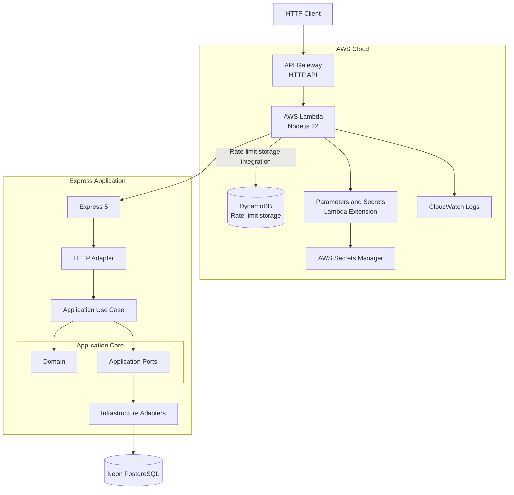
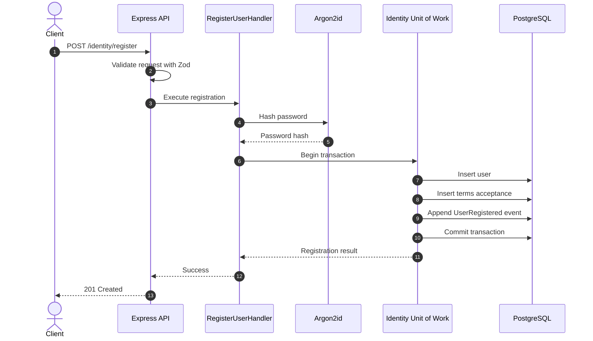
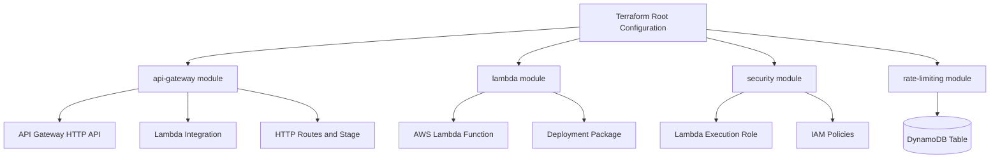

# Restaurant CMV API

Backend API for the Restaurant CMV platform, built with Node.js, TypeScript, and Express.

The application follows a modular, hexagonal architecture, with PostgreSQL persistence through Drizzle ORM. It runs locally or as an AWS Lambda function behind Amazon API Gateway.

PostgreSQL is hosted by [Neon](https://neon.tech/), while Terraform manages the AWS infrastructure.

## Technology Stack

| Category | Technology |
|---|---|
| Runtime | Node.js 22 |
| Language | TypeScript |
| HTTP framework | Express 5 |
| Validation | Zod 4 |
| Database | PostgreSQL 18 |
| ORM | Drizzle ORM |
| Database driver | node-postgres (`pg`) |
| Password hashing | Argon2id |
| HTTP testing | Supertest |
| Test framework | Vitest |
| Integration testing | Testcontainers |
| Cloud runtime | AWS Lambda |
| API gateway | Amazon API Gateway HTTP API |
| Rate-limit storage | Amazon DynamoDB |
| Secrets management | AWS Secrets Manager |
| Secrets retrieval | AWS Parameters and Secrets Lambda Extension |
| Infrastructure as Code | Terraform |

## Architecture

The application follows **Hexagonal Architecture (Ports and Adapters)**, with business logic isolated from delivery mechanisms, frameworks, and infrastructure implementations.

The architecture has four primary boundaries:

- **Domain:** Business entities, value objects, and domain events.
- **Application:** Use cases, commands, validation, and application ports.
- **Infrastructure:** Database adapters, repositories, external services, and persistence implementations.
- **Delivery:** HTTP and Lambda entry points.

Application use cases depend on interfaces defined by the application layer. Infrastructure provides implementations of those interfaces.

### System Architecture



The same Express application is used for local development and Lambda execution. `serverless-http` adapts the Express application to the AWS Lambda event model.

The DynamoDB table is provisioned for registration rate-limit state. API Gateway also provides route-level throttling. Application-level per-IP enforcement depends on the Lambda rate-limiting adapter being wired into the request path.

### Registration Flow

Registration is implemented as an application use case. User creation, terms acceptance, and the corresponding outbox event are persisted in a single database transaction.



If any persistence operation fails, the transaction is rolled back. A user cannot be created without the associated terms acceptance and outbox event.

### Deployment Architecture

Terraform separates infrastructure responsibilities into four modules.



Each module owns a distinct infrastructure responsibility. The root configuration composes these modules and supplies their dependencies.

## Project Structure

```text
restaurant-cmv/
├── src/
│   ├── config/
│   │   └── env.ts
│   ├── modules/
│   │   └── identity/
│   │       ├── application/
│   │       │   ├── commands/
│   │       │   │   ├── register-user.handler.ts
│   │       │   │   └── register-user.schema.ts
│   │       │   ├── ports/
│   │       │   └── email-already-registered.error.ts
│   │       └── domain/
│   │           ├── value-objects/
│   │           ├── terms-acceptance.ts
│   │           ├── user-registered.event.ts
│   │           └── user.ts
│   ├── infrastructure/
│   │   ├── database/
│   │   │   ├── identity/
│   │   │   │   └── repositories/
│   │   │   ├── schema/
│   │   │   ├── client.ts
│   │   │   └── postgres.ts
│   │   ├── identity/
│   │   │   └── registration.ts
│   │   └── secrets/
│   │       └── secrets-manager.ts
│   ├── app.ts
│   ├── lambda.ts
│   └── server.ts
├── drizzle/
│   ├── meta/
│   └── migrations/
├── terraform/
│   ├── modules/
│   │   ├── api-gateway/
│   │   ├── lambda/
│   │   ├── rate-limiting/
│   │   └── security/
│   ├── main.tf
│   ├── outputs.tf
│   ├── provider.tf
│   ├── variables.tf
│   └── versions.tf
├── tests/
│   ├── integration/
│   └── unit/
├── Makefile
├── drizzle.config.ts
├── package.json
├── package-lock.json
├── tsconfig.json
└── README.md
```

The project is organised around business capabilities rather than framework-specific controllers or generic service layers.

## Prerequisites

Install the following tools:

- Node.js 22 or later
- npm
- GNU Make
- Docker (required for PostgreSQL integration tests)
- Terraform
- AWS CLI
- An AWS account configured with credentials for the target account and region
- A Neon PostgreSQL database

Verify the installation:

```bash
node --version
npm --version
make --version
docker --version
terraform version
aws --version
```

## Getting Started

Clone the repository and install dependencies:

```bash
git clone <repository-url>
cd restaurant-cmv
make install
```

### Environment Configuration

Create a local `.env` file in the project root. Do not commit this file.

```dotenv
NODE_ENV=development
PORT=3000
LOG_LEVEL=debug
DATABASE_URL=postgresql://<user>:<password>@<host>/<database>?sslmode=require
```

Replace the placeholders with the connection details from your Neon project.

Use a pooled Neon connection string where appropriate for serverless workloads.

### Run Locally

Start the development server:

```bash
make dev
```

The API listens on:

```text
http://localhost:3000
```

## Identity and Registration

The Identity module owns account registration and identity-related domain behaviour.

Registration currently includes:

- First and last name
- Email address
- International-format phone number
- Password
- Explicit acceptance of the Terms of Service

### Registration Invariants

The application enforces the following rules:

- Email addresses are normalised before persistence.
- Passwords are hashed using Argon2id.
- The client cannot provide the terms acceptance timestamp.
- The client cannot select the Terms of Service version.
- Terms acceptance is persisted as a separate record.
- User creation, terms acceptance, and the corresponding domain event are persisted within one database transaction.
- Duplicate email addresses are rejected.
- Domain and application logic remain independent of Express and Drizzle.

### Transactional Outbox

Domain events are persisted in the same database transaction as their associated business operation.

The outbox provides durable event persistence. Event dispatch and external event publishing are not yet implemented.

## API Endpoints

| Method | Endpoint | Description |
|---|---|---|
| GET | `/health` | Basic API health check |
| GET | `/ready` | Database connectivity check |
| POST | `/identity/register` | Register a new account |

### Health Checks

```bash
curl -i http://localhost:3000/health
curl -i http://localhost:3000/ready
```

For the deployed API:

```bash
make check
```

The `/health` endpoint verifies that the application is responding. The `/ready` endpoint verifies that the application can connect to PostgreSQL.

A successful health check alone does not guarantee database availability.

### Account Registration

Example request:

```bash
curl -i -X POST http://localhost:3000/identity/register \
  -H "Content-Type: application/json" \
  -d '{
    "firstName": "Test",
    "lastName": "User",
    "email": "test@example.com",
    "phone": "+15555550100",
    "password": "synthetic-test-password",
    "acceptTerms": true
  }'
```

The request is validated using Zod before the registration use case executes.

## Database

PostgreSQL is hosted by Neon.

Drizzle ORM provides typed database access, schema definitions, and migration management.

### Schema and Migrations

Database schemas are maintained in:

```text
src/infrastructure/database/schema/
```

Generate a migration after intentionally changing the database schema:

```bash
npm run db:generate
```

Apply migrations:

```bash
npm run db:migrate
```

Open Drizzle Studio:

```bash
npm run db:studio
```

Review generated migrations before applying them. Previously applied migrations should be treated as immutable.

### Integration Testing Database

Integration tests use Testcontainers to provision disposable PostgreSQL instances.

They apply the project's migrations and exercise the actual database adapters and transaction boundaries.

Integration tests must never run against the production or development Neon database.

## Security

Security controls are applied at both application and infrastructure boundaries.

### Password Security

Passwords are hashed using Argon2id. Plain-text passwords are never persisted.

The packaged Argon2 dependency has also been verified inside the AWS Lambda Node.js 22 x86_64 runtime image.

### Registration Rate Limiting

The infrastructure provisions a DynamoDB table for registration rate-limit state.

The current Terraform configuration includes:

- On-demand DynamoDB capacity.
- A partition key identifying the rate-limit subject.
- A sort key identifying the rate-limit window.
- TTL-based expiration.
- Server-side encryption.

The configured registration limits are:

| Setting | Value |
|---|---:|
| Maximum attempts | 5 |
| Rate-limit window | 900 seconds |
| API Gateway route rate | 2 requests/second |
| API Gateway burst limit | 5 |

API Gateway throttling is an additional protection and is not a substitute for per-IP application-level enforcement.

### Secrets Management

In local development, the database connection string is supplied through `.env`.

In AWS:

- Lambda receives the secret ARN through `DB_SECRET_ARN`.
- AWS Secrets Manager stores the actual database connection string.
- The Lambda execution role has scoped permission to retrieve the configured secret.
- The AWS Parameters and Secrets Lambda Extension retrieves the secret during Lambda execution.

Never log secret payloads or expose credentials in application responses.

## AWS Infrastructure

Terraform configuration is located in `terraform/`.

The current deployment uses:

| Component | Responsibility |
|---|---|
| API Gateway HTTP API | Public HTTP entry point |
| AWS Lambda | Application runtime |
| AWS IAM | Execution role and permissions |
| DynamoDB | Registration rate-limit storage |
| AWS Secrets Manager | Database connection credentials |
| Parameters and Secrets Lambda Extension | Secret retrieval |
| CloudWatch Logs | Application and runtime logs |
| Neon | PostgreSQL hosting |

The database is hosted by Neon, not Amazon RDS.

The Lambda function runs Node.js 22 and uses the `serverless-http` adapter to expose the Express application.

The Lambda function is not attached to a VPC in the current setup. It connects to Neon over the internet without provisioning NAT infrastructure.

### Configure AWS Credentials

Configure the AWS CLI using your preferred credential method. For example:

```bash
aws configure
```

Verify the active identity:

```bash
aws sts get-caller-identity
```

The Terraform provider currently targets `us-east-1`.

### Configure the Database Secret

Create a secret in AWS Secrets Manager with the name configured by Terraform.

The current default name is:

```text
restaurant-cmv-api/database
```

Its secret value must be JSON with this structure:

```json
{
  "DATABASE_URL": "postgresql://<user>:<password>@<host>/<database>?sslmode=require"
}
```

Use the actual Neon connection string as the value.

Never put credentials directly into Terraform source files, application code, README files, or version control.

Terraform reads the secret metadata to configure IAM and Lambda. The secret value should remain managed in Secrets Manager rather than being declared as a Terraform-managed secret value.

### Terraform Modules

```text
terraform/
├── modules/
│   ├── api-gateway/
│   ├── lambda/
│   ├── rate-limiting/
│   └── security/
├── main.tf
├── outputs.tf
├── provider.tf
├── variables.tf
└── versions.tf
```

The root configuration composes the modules. Each module manages its own resources, variables, outputs, and provider requirements.

## Development Workflow

Run `make` to display available targets.

| Command | Description |
|---|---|
| `make` | Display available commands |
| `make install` | Install project dependencies |
| `make dev` | Start the local development server |
| `make test` | Run the test suite |
| `make build` | Compile TypeScript |
| `make package` | Build the Lambda deployment staging directory |
| `make terraform-fmt` | Format Terraform files |
| `make terraform-validate` | Validate Terraform configuration |
| `make terraform-plan` | Package the application and preview Terraform changes |
| `make terraform-apply` | Package the application and apply Terraform changes |
| `make deploy` | Run tests, format and validate Terraform, then apply changes |
| `make logs` | Follow Lambda CloudWatch logs |
| `make status` | Inspect the deployed Lambda configuration |
| `make health` | Call the API health endpoint |
| `make ready` | Check API and database readiness |
| `make check` | Run both health checks |
| `make clean` | Remove generated build artifacts |

### Typical Development Workflow

Start the application:

```bash
make dev
```

In another terminal:

```bash
make test
make build
```

### Deployment Workflow

First review the infrastructure changes:

```bash
make terraform-plan
```

If the plan is correct, deploy:

```bash
make deploy
```

`make deploy` runs the configured checks and applies Terraform changes. Terraform normally asks for confirmation before making infrastructure modifications.

Review the plan carefully before approving it.

## Testing

The project uses Vitest for automated testing and Supertest for HTTP-level tests.

Testcontainers provides disposable PostgreSQL instances for integration testing.

The test suite covers:

- Registration validation.
- Domain and application behaviour.
- Duplicate email handling.
- HTTP response behaviour.
- Database transaction commits.
- Database transaction rollbacks.
- Persistence constraints.
- Database adapter behaviour.

Run the complete test suite:

```bash
make test
```

Compile TypeScript:

```bash
make build
```

Before deploying, ensure tests and the production build complete successfully.

## Logs and Troubleshooting

Follow Lambda logs:

```bash
make logs
```

Inspect Lambda configuration:

```bash
make status
```

Check the deployed endpoints:

```bash
make health
make ready
```

If `/health` succeeds but `/ready` fails, investigate:

- The database connection.
- The Neon connection string.
- Lambda secret permissions.
- Lambda logs.

Do not print or share the database connection string when troubleshooting.

## Security and Operational Considerations

- Never commit `.env`, AWS credentials, database URLs, or secret values.
- Keep `.env` out of the Lambda deployment package.
- Do not log database credentials or secret payloads.
- Keep IAM permissions scoped to the resources required by Lambda.
- Review Terraform plans before applying infrastructure changes.
- Monitor Lambda concurrency and PostgreSQL connection limits.
- Each warm Lambda execution environment maintains its own PostgreSQL connection pool.
- Use a pooled Neon connection endpoint where appropriate for serverless workloads.
- Keep database migrations reviewed and version-controlled.
- Use disposable databases for integration tests.

Terraform state must be protected and stored appropriately for the deployment environment. Do not commit local Terraform state files, plan files, or generated Lambda deployment artifacts.

## Current Implementation Scope

The current implementation establishes the application foundation and Identity registration flow.

Implemented capabilities include:

- Modular application structure.
- Identity registration.
- Email normalisation and uniqueness enforcement.
- Argon2id password hashing.
- Server-controlled terms acceptance.
- Transactional persistence of users, terms acceptance, and outbox events.
- PostgreSQL persistence through Drizzle.
- Database integration testing with Testcontainers.
- Express HTTP delivery.
- AWS Lambda deployment.
- Terraform-managed AWS infrastructure.

The transactional outbox currently provides durable event persistence. An event publisher and background dispatch mechanism remain future work.

## Licence

Add the project's chosen licence here before publishing or distributing the repository.
