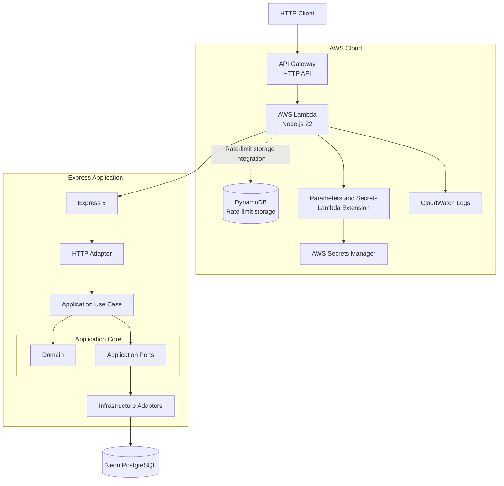
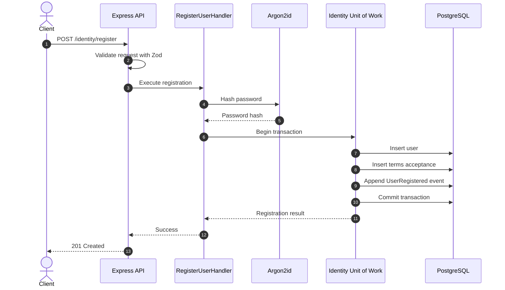
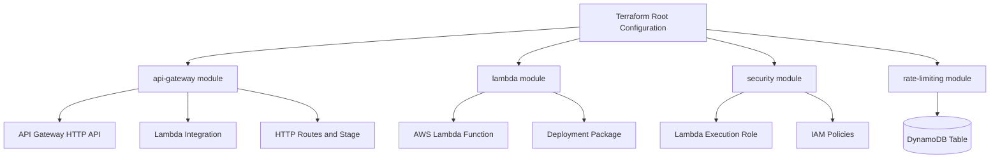

# Orbis API

Backend API da plataforma **Orbis**, desenvolvida com Node.js, TypeScript e Express.

A aplicação utiliza uma arquitetura modular baseada em **Hexagonal Architecture (Ports and Adapters)**, com persistência em PostgreSQL através do Drizzle ORM. Pode ser executada localmente ou como uma AWS Lambda Function integrada ao Amazon API Gateway.

O PostgreSQL é hospedado pela [Neon](https://neon.tech/), enquanto a infraestrutura AWS é gerenciada com Terraform.

## Technology Stack

| Categoria | Tecnologia |
|---|---|
| Runtime | Node.js 22 |
| Linguagem | TypeScript |
| HTTP Framework | Express 5 |
| Validação | Zod 4 |
| Banco de dados | PostgreSQL 18 |
| ORM | Drizzle ORM |
| Database Driver | node-postgres (`pg`) |
| Password Hashing | Argon2id |
| HTTP Testing | Supertest |
| Test Framework | Vitest |
| Integration Testing | Testcontainers |
| Cloud Runtime | AWS Lambda |
| API Gateway | Amazon API Gateway HTTP API |
| Rate-limit Storage | Amazon DynamoDB |
| Secrets Management | AWS Secrets Manager |
| Secrets Retrieval | AWS Parameters and Secrets Lambda Extension |
| Infrastructure as Code | Terraform |

## Arquitetura

A aplicação segue os princípios de **Hexagonal Architecture (Ports and Adapters)**, mantendo as regras de negócio isoladas dos mecanismos de entrega, frameworks e implementações de infraestrutura.

A arquitetura possui quatro boundaries principais:

- **Domain:** entidades de negócio, value objects e domain events.
- **Application:** use cases, commands, validações e application ports.
- **Infrastructure:** database adapters, repositories, serviços externos e implementações de persistência.
- **Delivery:** pontos de entrada HTTP e Lambda.

Os use cases dependem de interfaces definidas na camada Application. A camada Infrastructure fornece as implementações dessas interfaces.

### System Architecture



A mesma aplicação Express é utilizada tanto no desenvolvimento local quanto na execução em Lambda. O `serverless-http` adapta a aplicação Express ao modelo de eventos do AWS Lambda.

A tabela DynamoDB é provisionada para armazenar o estado do rate limiting do fluxo de registro. O API Gateway também oferece throttling por rota. A aplicação de limites por IP depende da integração do rate-limiting adapter ao fluxo de requisições da Lambda.

### Registration Flow

O processo de registro é implementado como um application use case. A criação do usuário, o aceite dos termos e o respectivo evento do outbox são persistidos em uma única transação de banco de dados.



Caso qualquer operação de persistência falhe, a transação é revertida (*rollback*). Dessa forma, um usuário não pode ser criado sem o respectivo registro de aceite dos termos e o evento no outbox.

### Deployment Architecture

A infraestrutura Terraform é organizada em quatro módulos, cada um responsável por uma parte específica da infraestrutura.



A configuração root compõe os módulos e fornece suas dependências. Cada módulo mantém a responsabilidade pelos próprios recursos, variáveis, outputs e configurações.

## Project Structure

```text
orbis/
├── src/
│   ├── config/
│   │   └── env.ts
│   ├── modules/
│   │   └── identity/
│   │       ├── application/
│   │       │   ├── commands/
│   │       │   │   ├── register-user.handler.ts
│   │       │   │   └── register-user.schema.ts
│   │       │   ├── ports/
│   │       │   └── email-already-registered.error.ts
│   │       └── domain/
│   │           ├── value-objects/
│   │           ├── terms-acceptance.ts
│   │           ├── user-registered.event.ts
│   │           └── user.ts
│   ├── infrastructure/
│   │   ├── database/
│   │   │   ├── identity/
│   │   │   │   └── repositories/
│   │   │   ├── schema/
│   │   │   ├── client.ts
│   │   │   └── postgres.ts
│   │   ├── identity/
│   │   │   └── registration.ts
│   │   └── secrets/
│   │       └── secrets-manager.ts
│   ├── app.ts
│   ├── lambda.ts
│   └── server.ts
├── drizzle/
│   ├── meta/
│   └── migrations/
├── terraform/
│   ├── modules/
│   │   ├── api-gateway/
│   │   ├── lambda/
│   │   ├── rate-limiting/
│   │   └── security/
│   ├── main.tf
│   ├── outputs.tf
│   ├── provider.tf
│   ├── variables.tf
│   └── versions.tf
├── tests/
│   ├── integration/
│   └── unit/
├── Makefile
├── drizzle.config.ts
├── package.json
├── package-lock.json
├── tsconfig.json
└── README.md
```

A organização do projeto é orientada por capacidades de negócio (*business capabilities*), em vez de controllers específicos de frameworks ou camadas genéricas de services.

## Pré-requisitos

Instale as seguintes ferramentas:

- Node.js 22 ou superior
- npm
- GNU Make
- Docker (necessário para os testes de integração com PostgreSQL)
- Terraform
- AWS CLI
- Conta AWS com credenciais configuradas para a região e conta de destino
- Banco de dados PostgreSQL na Neon

Verifique as instalações:

```bash
node --version
npm --version
make --version
docker --version
terraform version
aws --version
```

## Getting Started

Clone o repositório e instale as dependências:

```bash
git clone <repository-url>
cd orbis
make install
```

### Configuração do ambiente

Crie um arquivo `.env` na raiz do projeto. Esse arquivo não deve ser versionado.

```dotenv
NODE_ENV=development
PORT=3000
LOG_LEVEL=debug
DATABASE_URL=postgresql://<user>:<password>@<host>/<database>?sslmode=require
```

Substitua os placeholders pelos dados de conexão do seu projeto Neon.

Para workloads serverless, utilize uma connection string com connection pooling quando apropriado.

### Execução local

Inicie o servidor de desenvolvimento:

```bash
make dev
```

A API ficará disponível em:

```text
http://localhost:3000
```

## Identity and Registration

O módulo Identity é responsável pelo registro de contas e pelas regras de negócio relacionadas à identidade dos usuários.

O fluxo de registro atualmente contempla:

- Primeiro e último nome
- Endereço de e-mail
- Número de telefone em formato internacional
- Senha
- Aceite explícito dos Terms of Service

### Registration Invariants

A aplicação garante as seguintes regras:

- Endereços de e-mail são normalizados antes da persistência.
- Senhas são armazenadas utilizando hashes Argon2id.
- O cliente não pode fornecer o timestamp de aceite dos termos.
- O cliente não pode selecionar a versão dos Terms of Service.
- O aceite dos termos é persistido em um registro separado.
- A criação do usuário, o aceite dos termos e o respectivo domain event são persistidos dentro de uma única transação.
- Endereços de e-mail duplicados são rejeitados.
- As regras de Domain e Application não dependem de Express ou Drizzle.

### Transactional Outbox

Os domain events são persistidos na mesma transação de banco de dados da operação de negócio correspondente.

O outbox garante a persistência durável dos eventos. O mecanismo de dispatch e a publicação de eventos externos ainda não foram implementados.

## API Endpoints

| Método | Endpoint | Descrição |
|---|---|---|
| GET | `/health` | Verificação básica de saúde da API |
| GET | `/ready` | Verificação de conectividade com o banco de dados |
| POST | `/identity/register` | Registro de uma nova conta |

### Health Checks

```bash
curl -i http://localhost:3000/health
curl -i http://localhost:3000/ready
```

Para a API em produção:

```bash
make check
```

O endpoint `/health` verifica se a aplicação está respondendo. O endpoint `/ready` verifica se a aplicação consegue estabelecer uma conexão com o PostgreSQL.

Um health check bem-sucedido, isoladamente, não garante a disponibilidade do banco de dados.

### Account Registration

Exemplo de requisição:

```bash
curl -i -X POST http://localhost:3000/identity/register \
  -H "Content-Type: application/json" \
  -d '{
    "firstName": "Test",
    "lastName": "User",
    "email": "test@example.com",
    "phone": "+15555550100",
    "password": "synthetic-test-password",
    "acceptTerms": true
  }'
```

A requisição é validada com Zod antes da execução do registration use case.

## Database

O PostgreSQL é hospedado pela Neon.

O Drizzle ORM fornece acesso tipado ao banco de dados, definições de schema e gerenciamento de migrations.

### Schema and Migrations

Os schemas do banco de dados estão localizados em:

```text
src/infrastructure/database/schema/
```

Gere uma migration após uma alteração intencional no schema:

```bash
npm run db:generate
```

Execute as migrations:

```bash
npm run db:migrate
```

Abra o Drizzle Studio:

```bash
npm run db:studio
```

Revise as migrations geradas antes de aplicá-las. Migrations já aplicadas devem ser tratadas como imutáveis.

### Integration Testing Database

Os testes de integração utilizam Testcontainers para provisionar instâncias descartáveis de PostgreSQL.

Esses testes aplicam as migrations do projeto e exercitam os database adapters e os limites transacionais reais.

Os testes de integração nunca devem ser executados contra o banco Neon de produção ou desenvolvimento.

## Security

Os controles de segurança são aplicados tanto nas boundaries da aplicação quanto na infraestrutura.

### Password Security

As senhas são armazenadas utilizando hashes Argon2id. Senhas em texto puro nunca são persistidas.

A dependência Argon2 empacotada também foi validada dentro da imagem de runtime AWS Lambda Node.js 22 para arquitetura x86_64.

### Registration Rate Limiting

A infraestrutura provisiona uma tabela DynamoDB para armazenar o estado do rate limiting do registro.

A configuração atual do Terraform inclui:

- Capacidade on-demand do DynamoDB.
- Partition key para identificar o sujeito do rate limit.
- Sort key para identificar a janela de tempo.
- Expiração baseada em TTL.
- Server-side encryption.

Os limites configurados para o registro são:

| Configuração | Valor |
|---|---:|
| Máximo de tentativas | 5 |
| Janela de rate limiting | 900 segundos |
| API Gateway route rate | 2 requisições/segundo |
| API Gateway burst limit | 5 |

O throttling do API Gateway é uma camada adicional de proteção e não substitui a implementação de rate limiting por IP na aplicação.

### Secrets Management

No desenvolvimento local, a connection string do banco é fornecida através do `.env`.

Na AWS:

- A Lambda recebe o ARN do secret através de `DB_SECRET_ARN`.
- O AWS Secrets Manager armazena a connection string real do banco.
- A execution role da Lambda possui permissão restrita para recuperar o secret configurado.
- O AWS Parameters and Secrets Lambda Extension recupera o secret durante a execução da Lambda.

Nunca registre o conteúdo de secrets nos logs nem exponha credenciais nas respostas da aplicação.

## AWS Infrastructure

A configuração Terraform está localizada em `terraform/`.

O deployment atual utiliza:

| Componente | Responsabilidade |
|---|---|
| API Gateway HTTP API | Ponto de entrada HTTP público |
| AWS Lambda | Runtime da aplicação |
| AWS IAM | Execution role e permissões |
| DynamoDB | Armazenamento do estado de rate limiting |
| AWS Secrets Manager | Credenciais de conexão com o banco |
| Parameters and Secrets Lambda Extension | Recuperação de secrets |
| CloudWatch Logs | Logs da aplicação e do runtime |
| Neon | Hospedagem do PostgreSQL |

O banco de dados é hospedado pela Neon, não pelo Amazon RDS.

A função Lambda utiliza Node.js 22 e o adapter `serverless-http` para disponibilizar a aplicação Express.

Na configuração atual, a Lambda não está conectada a uma VPC. A conexão com a Neon é realizada pela internet, sem necessidade de provisionar infraestrutura NAT.

### Configuração das credenciais AWS

Configure a AWS CLI utilizando o método de autenticação de sua preferência. Por exemplo:

```bash
aws configure
```

Verifique a identidade AWS ativa:

```bash
aws sts get-caller-identity
```

O provider Terraform está configurado para utilizar a região `us-east-1`.

### Configuração do Database Secret

Crie um secret no AWS Secrets Manager com o nome configurado pelo Terraform.

O nome padrão atual é:

```text
restaurant-cmv-api/database
```

O valor do secret deve ser um JSON com a seguinte estrutura:

```json
{
  "DATABASE_URL": "postgresql://<user>:<password>@<host>/<database>?sslmode=require"
}
```

Utilize a connection string real do projeto Neon como valor.

Nunca coloque credenciais diretamente nos arquivos Terraform, no código da aplicação, no README ou no version control.

O Terraform consulta os metadados do secret para configurar IAM e Lambda. O valor do secret deve permanecer gerenciado pelo Secrets Manager, em vez de ser declarado como um valor de secret gerenciado pelo Terraform.

### Terraform Modules

```text
terraform/
├── modules/
│   ├── api-gateway/
│   ├── lambda/
│   ├── rate-limiting/
│   └── security/
├── main.tf
├── outputs.tf
├── provider.tf
├── variables.tf
└── versions.tf
```

A configuração root compõe os módulos. Cada módulo gerencia seus próprios recursos, variáveis, outputs e requisitos de providers.

## Development Workflow

Execute `make` para visualizar os comandos disponíveis.

| Comando | Descrição |
|---|---|
| `make` | Exibe os comandos disponíveis |
| `make install` | Instala as dependências do projeto |
| `make dev` | Inicia o servidor de desenvolvimento local |
| `make test` | Executa a suíte de testes |
| `make build` | Compila o TypeScript |
| `make package` | Prepara o diretório de staging do deployment Lambda |
| `make terraform-fmt` | Formata os arquivos Terraform |
| `make terraform-validate` | Valida a configuração Terraform |
| `make terraform-plan` | Empacota a aplicação e apresenta o plano de alterações Terraform |
| `make terraform-apply` | Empacota a aplicação e aplica as alterações Terraform |
| `make deploy` | Executa os testes, formata e valida o Terraform e aplica as alterações |
| `make logs` | Acompanha os logs da Lambda no CloudWatch |
| `make status` | Inspeciona a configuração da Lambda implantada |
| `make health` | Executa o health check da API |
| `make ready` | Verifica a API e a disponibilidade do banco |
| `make check` | Executa os dois health checks |
| `make clean` | Remove os artefatos de build gerados |

### Typical Development Workflow

Inicie a aplicação:

```bash
make dev
```

Em outro terminal:

```bash
make test
make build
```

### Deployment Workflow

Primeiro, revise as alterações de infraestrutura:

```bash
make terraform-plan
```

Se o plano estiver correto, execute o deployment:

```bash
make deploy
```

O comando `make deploy` executa as verificações configuradas e aplica as alterações Terraform. Por padrão, o Terraform solicita confirmação antes de modificar a infraestrutura.

Revise cuidadosamente o plano antes de aprovar qualquer alteração.

## Testing

O projeto utiliza Vitest para testes automatizados e Supertest para testes HTTP.

Testcontainers fornece instâncias descartáveis de PostgreSQL para os testes de integração.

A suíte de testes contempla:

- Validação do registro.
- Comportamento de Domain e Application.
- Tratamento de e-mails duplicados.
- Comportamento das respostas HTTP.
- Commit de transações no banco.
- Rollback de transações no banco.
- Restrições de persistência.
- Comportamento dos database adapters.

Execute a suíte completa:

```bash
make test
```

Compile o TypeScript:

```bash
make build
```

Antes de realizar um deployment, garanta que os testes e o build de produção sejam executados com sucesso.

## Logs and Troubleshooting

Acompanhe os logs da Lambda:

```bash
make logs
```

Inspecione a configuração da Lambda:

```bash
make status
```

Verifique os endpoints implantados:

```bash
make health
make ready
```

Se `/health` responder corretamente, mas `/ready` falhar, investigue:

- A conexão com o banco de dados.
- A connection string da Neon.
- As permissões da Lambda para recuperar o secret.
- Os logs da Lambda.

Não imprima nem compartilhe a connection string do banco durante o troubleshooting.

## Security and Operational Considerations

- Nunca versione `.env`, credenciais AWS, database URLs ou valores de secrets.
- Mantenha `.env` fora do deployment package da Lambda.
- Não registre credenciais do banco ou payloads de secrets nos logs.
- Mantenha as permissões IAM restritas aos recursos necessários para a Lambda.
- Revise os planos Terraform antes de aplicar alterações na infraestrutura.
- Monitore a concorrência da Lambda e os limites de conexões do PostgreSQL.
- Cada ambiente de execução Lambda aquecido mantém seu próprio connection pool PostgreSQL.
- Utilize um endpoint Neon com connection pooling quando apropriado para workloads serverless.
- Mantenha as migrations revisadas e versionadas.
- Utilize bancos descartáveis para testes de integração.

O Terraform state deve ser protegido e armazenado adequadamente para o ambiente de deployment. Não versione arquivos locais de state, plan files ou artefatos gerados para o deployment da Lambda.

## Current Implementation Scope

A implementação atual estabelece a fundação da aplicação e o fluxo de registro do módulo Identity.

As funcionalidades implementadas incluem:

- Estrutura modular da aplicação.
- Registro de usuários através do Identity.
- Normalização e garantia de unicidade de e-mail.
- Password hashing com Argon2id.
- Aceite dos termos controlado pelo servidor.
- Persistência transacional de usuários, aceite dos termos e eventos do outbox.
- Persistência PostgreSQL através do Drizzle ORM.
- Testes de integração com Testcontainers.
- HTTP delivery com Express.
- Deployment em AWS Lambda.
- Infraestrutura AWS gerenciada pelo Terraform.

O transactional outbox atualmente garante a persistência durável dos eventos. Um event publisher e o mecanismo de dispatch em background permanecem como trabalho futuro.

## Licence

Adicione a licença escolhida para o projeto antes de publicar ou distribuir o repositório.
