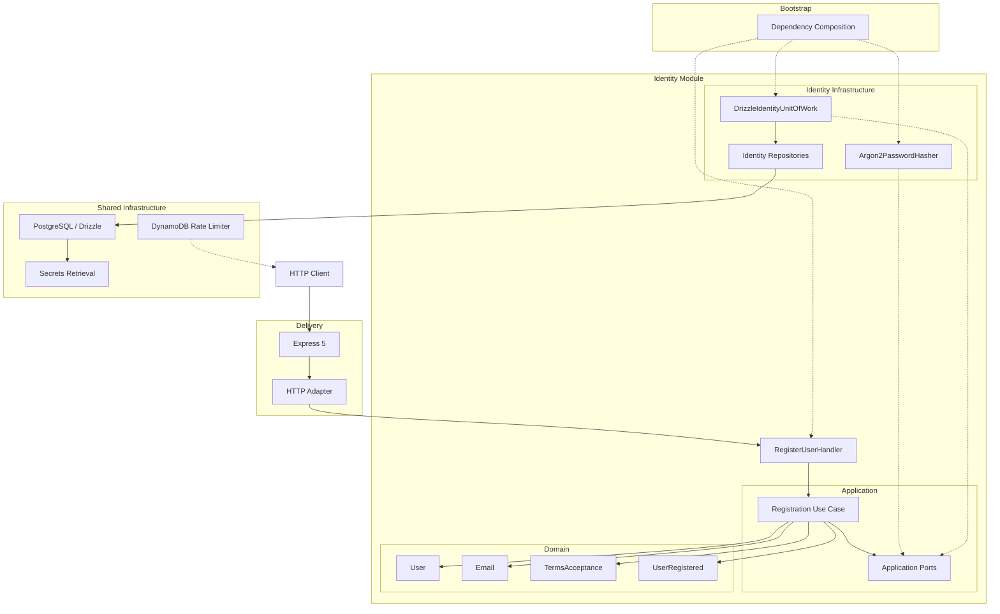
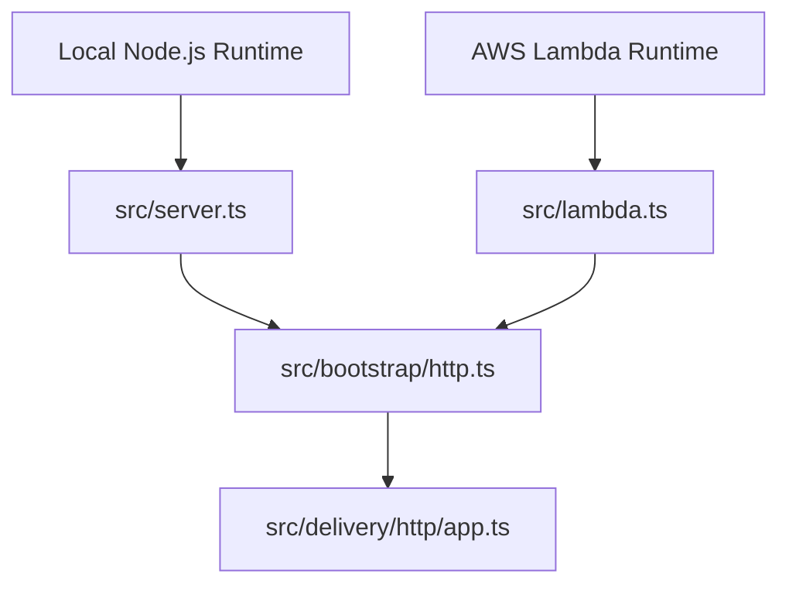
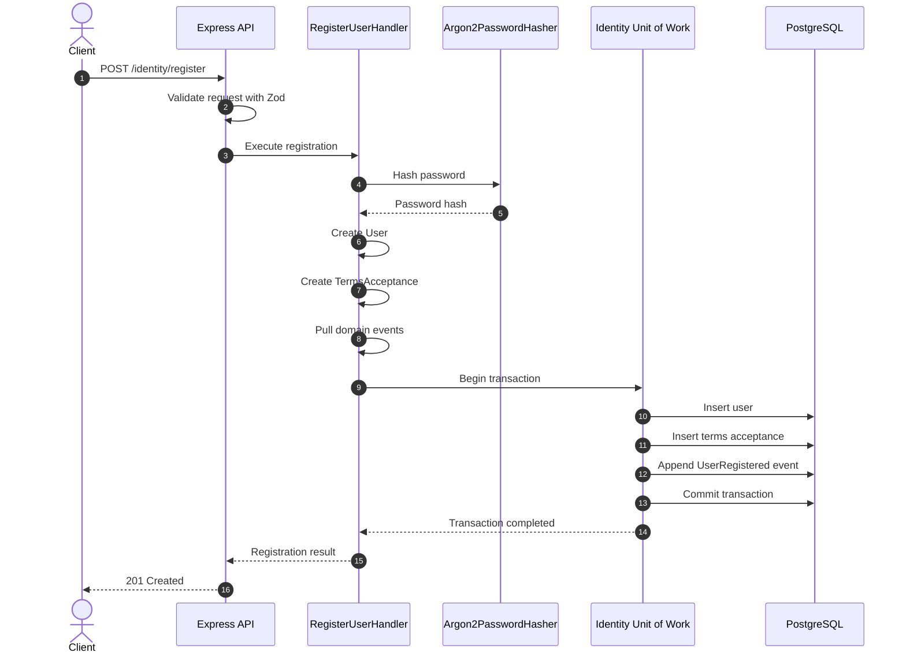

# Architecture

Orbis API follows **Hexagonal Architecture (Ports and Adapters)**, organised around business capabilities.

The architecture separates business rules from delivery mechanisms, frameworks and infrastructure implementations. Application use cases depend on ports, while infrastructure adapters implement those ports.

## Architectural Boundaries

The application has five main architectural responsibilities.

| Boundary | Responsibility |
|---|---|
| Bootstrap | Composition roots and dependency wiring |
| Delivery | HTTP and other external entry points |
| Domain | Business entities, value objects, invariants and domain events |
| Application | Use cases, commands and application ports |
| Infrastructure | Persistence, database connectivity, cryptography and external integrations |

### Bootstrap

The bootstrap layer composes the application.

It instantiates application handlers, infrastructure adapters and their dependencies. It is the place where concrete implementations are connected to application ports.

Current composition roots:

- `src/bootstrap/http.ts`
- `src/bootstrap/identity.ts`

`http.ts` creates the Express application and supplies its dependencies.

`identity.ts` creates and caches the registration handler and its dependencies.

### Delivery

The delivery layer handles incoming requests and translates them into application operations.

Current HTTP implementation:

```text
src/delivery/http/
└── app.ts
```

The Express application is created through `createApp()`, which receives its dependencies explicitly.

This allows HTTP behaviour to be tested independently from the production database and infrastructure.

### Domain

The domain layer contains business concepts and rules.

It does not depend on Express, Drizzle ORM, PostgreSQL or AWS.

The Identity domain currently includes:

- `User`
- `TermsAcceptance`
- `UserRegistered`
- `Email`

The `User` entity starts with the `pending_email_verification` status when registered.

### Application

The application layer implements use cases and defines the ports required by those use cases.

The registration use case is implemented by `RegisterUserHandler`.

Its dependencies are expressed through interfaces:

- `IdGenerator`
- `Clock`
- `PasswordHasher`
- `TermsPolicy`
- `IdentityUnitOfWork`

The handler does not instantiate infrastructure implementations.

### Infrastructure

Infrastructure contains concrete implementations of application ports and shared technical capabilities.

Identity-specific adapters are owned by the Identity module.

Shared database connectivity, database schemas, secrets retrieval and rate-limiting integrations remain under `src/infrastructure/`.

## System Architecture



The diagram shows logical responsibilities and dependencies. The Lambda rate limiter executes before the Express application receives registration requests.

## Dependency Direction

The architecture follows these dependency rules:

1. Domain does not depend on Application, Delivery or Infrastructure.
2. Application depends on Domain and its own ports.
3. Infrastructure implements ports defined by Application.
4. Delivery translates external requests into application commands.
5. Bootstrap connects concrete implementations to application dependencies.

The dependency direction keeps business rules independent from external technologies.

## Project Structure

The following tree represents the main application and infrastructure boundaries.

```text
src/
├── bootstrap/
│   ├── http.ts
│   └── identity.ts
│
├── config/
│   └── env.ts
│
├── delivery/
│   └── http/
│       └── app.ts
│
├── modules/
│   └── identity/
│       ├── application/
│       │   ├── commands/
│       │   │   ├── register-user.handler.ts
│       │   │   └── register-user.schema.ts
│       │   ├── ports/
│       │   └── email-already-registered.error.ts
│       │
│       ├── domain/
│       │   ├── value-objects/
│       │   ├── user.ts
│       │   ├── user.schema.ts
│       │   ├── terms-acceptance.ts
│       │   └── user-registered.event.ts
│       │
│       └── infrastructure/
│           ├── cryptography/
│           │   └── argon2-password-hasher.ts
│           └── persistence/
│               ├── drizzle-identity-unit-of-work.ts
│               └── repositories/
│
├── infrastructure/
│   ├── database/
│   │   ├── schema/
│   │   ├── client.ts
│   │   └── postgres.ts
│   ├── rate-limiting/
│   │   └── dynamodb-registration-rate-limiter.ts
│   └── secrets/
│       └── secrets-manager.ts
│
├── lambda.ts
└── server.ts
```

The tree intentionally focuses on the main architectural boundaries. Tests, migrations, Terraform and CI/CD configuration are maintained outside `src/`.

## HTTP Application Composition

The application has two execution entry points:

- `src/server.ts` starts the Express application as a local Node.js server.
- `src/lambda.ts` adapts the same Express application to AWS Lambda through `serverless-http`.

Both entry points use the application composed in `src/bootstrap/http.ts`.



The HTTP application receives its dependencies through `createApp()`. It does not directly instantiate database connections or infrastructure adapters.

## Registration Flow

Registration is implemented by `RegisterUserHandler`.

The HTTP boundary validates the incoming request with Zod before executing the use case.



The registration operation:

1. Hashes the supplied password using Argon2id.
2. Creates a new user with a server-generated identifier.
3. Normalises the email address through the domain value object.
4. Creates the corresponding Terms of Service acceptance record.
5. Retrieves the domain events raised by the user.
6. Persists the user, terms acceptance and outbox events in one database transaction.

The client cannot choose the acceptance timestamp or Terms of Service version. The version is provided by the configured `TermsPolicy`.

If a persistence operation fails, the transaction is rolled back. A partially registered user cannot be committed without the associated terms acceptance and outbox event.

## Transactional Outbox

The Identity module uses a transactional outbox to persist domain events reliably.

The `UserRegistered` event is appended to the outbox inside the same transaction as the user and terms acceptance records.

This guarantees that the event is persisted if and only if the registration transaction commits.

Current implementation status:

| Capability | Status |
|---|---|
| Domain event creation | Implemented |
| Outbox persistence | Implemented |
| Transactional event insertion | Implemented |
| Background outbox dispatcher | Not implemented |
| External event publisher | Not implemented |

The outbox currently provides durable event persistence. It does not yet deliver events to external systems.

## Database Architecture

PostgreSQL is hosted by Neon.

Drizzle ORM provides typed database access and schema management. The shared database client is located at:

```text
src/infrastructure/database/
├── schema/
├── client.ts
└── postgres.ts
```

Identity-specific persistence adapters are located inside the Identity module:

```text
src/modules/identity/infrastructure/persistence/
├── drizzle-identity-unit-of-work.ts
└── repositories/
```

The Identity Unit of Work creates transaction-scoped repositories and executes the supplied operation within a Drizzle transaction.

Database schemas and migrations are maintained separately from domain entities.

## Testing Strategy

The project uses:

- Vitest for unit and integration test execution.
- Supertest for HTTP-level testing.
- Testcontainers for disposable PostgreSQL instances.

Tests are organised around the application boundaries.

Integration tests exercise real PostgreSQL behaviour, including persistence constraints and transaction commit and rollback behaviour.

Integration tests must use disposable databases and must never connect to production databases.

Run the test suite:

```bash
make test
```

Compile the application:

```bash
make build
```

## Architectural Principles

The architecture is guided by the following principles:

- Business capabilities own their domain and application logic.
- Application use cases depend on ports, not infrastructure implementations.
- Infrastructure adapters implement application-defined contracts.
- Domain rules remain independent of frameworks and databases.
- Composition happens at explicit bootstrap boundaries.
- HTTP delivery remains separate from business logic.
- Persistence operations that form one business action share a transaction.
- Integration tests verify real infrastructure behaviour.
