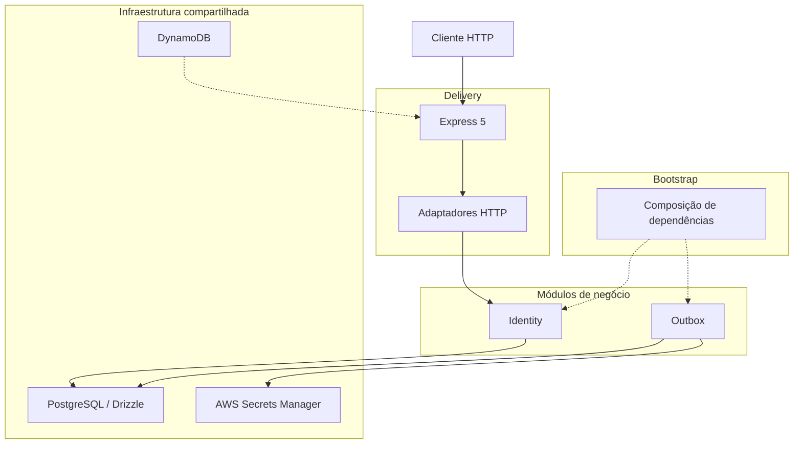
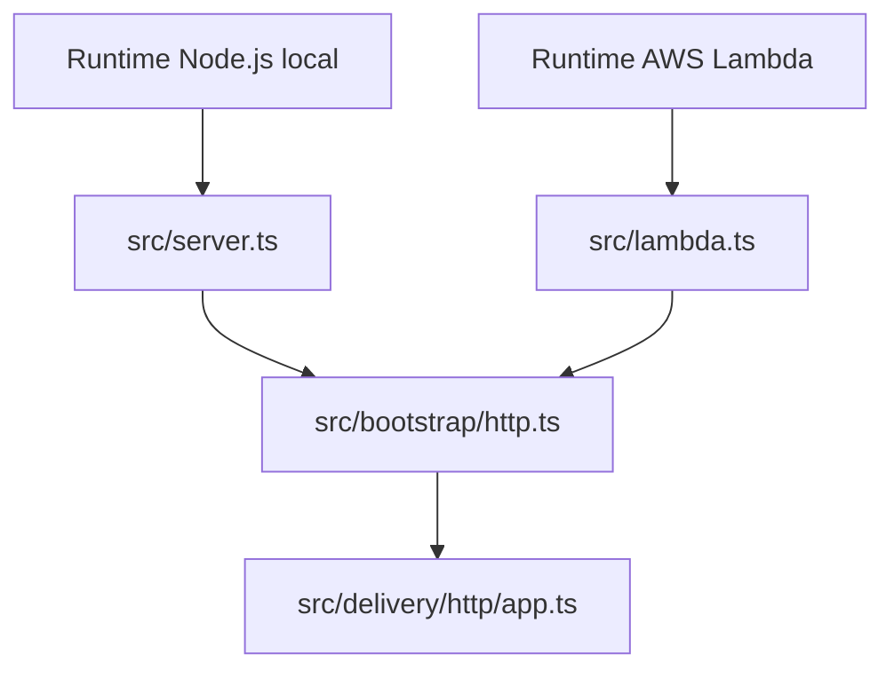

# Arquitetura

A API Orbis segue **Arquitetura Hexagonal (Ports and Adapters)** e é organizada em torno de capacidades de negócio.

A arquitetura separa as regras de negócio dos mecanismos de entrega, frameworks e implementações de infraestrutura. Os casos de uso dependem de portas definidas pela aplicação, enquanto adaptadores concretos implementam essas portas.

## Fronteiras arquiteturais

| Camada ou fronteira | Responsabilidade |
|---|---|
| Bootstrap | Composição de dependências e inicialização |
| Delivery | Entrada de requisições HTTP e outros mecanismos externos |
| Domain | Entidades, objetos de valor, invariantes e eventos de domínio |
| Application | Casos de uso, comandos, consultas e portas |
| Infrastructure | Persistência, banco de dados, criptografia e integrações externas |

### Bootstrap

A camada de bootstrap conecta as implementações concretas às dependências exigidas pelos casos de uso.

Ela instancia handlers, adaptadores de infraestrutura e suas dependências. É o ponto de composição da aplicação.

Composições atuais incluem:

- `src/bootstrap/http.ts`
- `src/bootstrap/identity.ts`
- `src/bootstrap/outbox.ts`

`http.ts` cria a aplicação Express e fornece suas dependências HTTP.

`identity.ts` compõe os handlers e adaptadores do módulo Identity.

`outbox.ts` compõe o publisher, o dispatcher, os handlers de eventos, os repositórios e os serviços de envio de e-mail.

### Delivery

A camada de entrega recebe requisições externas, valida os dados de entrada e encaminha a operação para o caso de uso correspondente.

A implementação HTTP está em:

```text
src/delivery/http/
├── app.ts
├── identity.http.ts
└── middleware/
```

A aplicação Express é criada por `createApp()`, que recebe suas dependências explicitamente. Isso permite testar o comportamento HTTP sem inicializar os adaptadores reais de produção.

### Domain

O domínio contém os conceitos e as regras centrais de cada capacidade de negócio.

Ele não deve depender de Express, Drizzle ORM, PostgreSQL, AWS ou serviços externos.

O domínio Identity inclui conceitos como:

- `User`
- `Email`
- `TermsAcceptance`
- `EmailVerificationToken`
- `EmailVerificationRequested`

O estado inicial de uma conta recém-cadastrada é `pending_email_verification`. A conta passa a `active` após a verificação de e-mail concluída com sucesso.

### Application

A camada de aplicação implementa os casos de uso e define as portas necessárias para executá-los.

Exemplos de casos de uso do Identity:

- `RegisterUserHandler`
- `LoginHandler`
- `VerifyEmailHandler`
- `GetUserProfileHandler`
- `GetActiveUserHandler`

As dependências são expressas por interfaces, como `Clock`, `IdGenerator`, `PasswordHasher`, `TermsPolicy`, `IdentityUnitOfWork`, `AccessTokenIssuer` e `AccessTokenVerifier`.

Os handlers não devem instanciar diretamente implementações de infraestrutura.

### Infrastructure

A infraestrutura contém implementações concretas das portas da aplicação e recursos técnicos compartilhados.

Adaptadores específicos de cada módulo pertencem ao próprio módulo. Recursos compartilhados, como conexão com banco, esquema de banco, carregamento de segredos e integração com serviços de nuvem, ficam em `src/infrastructure/`.

## Visão geral do sistema



O diagrama representa responsabilidades lógicas. A limitação de requisições de cadastro é aplicada no adaptador da Lambda antes de a requisição chegar à aplicação Express.

## Direção das dependências

A arquitetura segue estas regras:

1. O domínio não depende das camadas Application, Delivery ou Infrastructure.
2. A aplicação depende do domínio e das próprias portas.
3. A infraestrutura implementa portas definidas pela aplicação.
4. A camada Delivery traduz requisições externas em operações da aplicação.
5. O Bootstrap conecta implementações concretas às dependências dos casos de uso.
6. Um módulo não deve depender dos detalhes internos de infraestrutura de outro módulo.

Essas regras mantêm as regras de negócio independentes das tecnologias externas.

## Estrutura do projeto

Estrutura resumida das fronteiras principais:

```text
src/
├── bootstrap/
│   ├── async-singleton.ts
│   ├── http.ts
│   ├── identity.ts
│   └── outbox.ts
│
├── config/
│
├── delivery/
│   └── http/
│       ├── app.ts
│       ├── identity.http.ts
│       └── middleware/
│
├── infrastructure/
│   ├── database/
│   ├── rate-limiting/
│   ├── secrets/
│   └── time/
│
├── modules/
│   ├── identity/
│   │   ├── application/
│   │   ├── domain/
│   │   └── infrastructure/
│   │
│   └── outbox/
│       ├── application/
│       └── infrastructure/
│
├── lambda.ts
├── outbox-lambda.ts
└── server.ts
```

A estrutura é resumida e não lista todos os arquivos. Testes, migrações, Terraform e configurações de CI/CD ficam fora de `src/`.

## Composição da aplicação HTTP

A aplicação possui dois pontos de entrada HTTP:

- `src/server.ts` inicia o Express como servidor Node.js local.
- `src/lambda.ts` adapta a mesma aplicação Express para AWS Lambda por meio de `serverless-http`.

Ambos utilizam a aplicação composta em `src/bootstrap/http.ts`.



A aplicação HTTP recebe suas dependências por `createApp()`. Ela não deve instanciar diretamente conexões com banco ou adaptadores de infraestrutura.

## Transações e consistência

Operações que representam uma única ação de negócio devem persistir seus dados relacionados dentro de uma mesma transação.

No cadastro, por exemplo, a criação do usuário, o registro do aceite dos Termos de Serviço, o token de verificação e o evento correspondente da Outbox são persistidos atomicamente.

A implementação do Identity Unit of Work delimita essa transação. A Outbox garante que o evento não seja perdido entre a confirmação da transação de negócio e o processamento assíncrono.

O processamento posterior do evento ocorre fora da transação original. Consulte [Identity](identity.md) e [Outbox](outbox.md).

## Testes

O projeto utiliza:

- Vitest para execução dos testes.
- Supertest para testes HTTP.
- Testcontainers para provisionar instâncias PostgreSQL descartáveis.

Os testes unitários verificam regras e casos de uso sem depender de serviços externos. Os testes de integração verificam o comportamento real dos adaptadores e do banco de dados.

Os testes de integração devem utilizar bancos descartáveis e nunca devem se conectar a bancos de produção.

```bash
make test
make build
```

## Princípios arquiteturais

- Cada módulo é responsável por sua capacidade de negócio.
- Casos de uso dependem de portas, não de implementações concretas.
- Adaptadores de infraestrutura implementam contratos da aplicação.
- O domínio permanece independente de frameworks e bancos de dados.
- A composição ocorre em pontos explícitos de bootstrap.
- A entrega HTTP permanece separada das regras de negócio.
- Operações relacionadas de persistência compartilham uma transação.
- Testes de integração verificam o comportamento real da infraestrutura.
