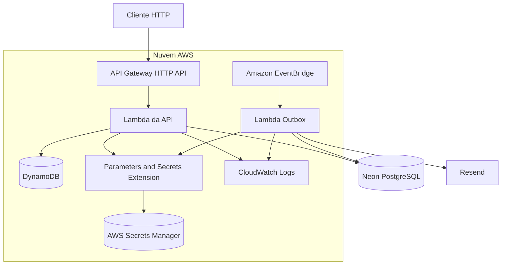
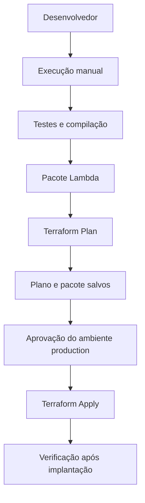

# Implantação e infraestrutura

Este documento descreve a infraestrutura AWS, a configuração Terraform, o gerenciamento de segredos e o processo de implantação de produção da API Orbis.

## Visão geral da infraestrutura

A aplicação pode ser executada localmente como processo Node.js ou em produção por meio de funções AWS Lambda.

| Componente | Responsabilidade |
|---|---|
| Amazon API Gateway HTTP API | Ponto de entrada HTTP público |
| AWS Lambda | Runtime da aplicação HTTP e do processador Outbox |
| Amazon DynamoDB | Armazenamento do limite de requisições de cadastro |
| AWS Secrets Manager | Credenciais e segredos da aplicação |
| Parameters and Secrets Lambda Extension | Consulta de segredos durante a execução |
| Amazon EventBridge | Agendamento do processamento Outbox |
| Amazon CloudWatch Logs | Logs da aplicação e das funções Lambda |
| Amazon S3 | Estado remoto do Terraform |
| GitHub Actions | CI/CD e implantação |
| AWS IAM OIDC | Autenticação do GitHub Actions na AWS |
| Neon | Hospedagem do PostgreSQL |
| Resend | Entrega de e-mails |

O PostgreSQL é hospedado pela Neon, não pelo Amazon RDS.

## Arquitetura de implantação



A Lambda HTTP utiliza `serverless-http` para disponibilizar a aplicação Express por meio do API Gateway.

A Lambda Outbox é independente e acionada pelo EventBridge.

### Configuração da Lambda HTTP

| Configuração | Valor |
|---|---|
| Runtime | `nodejs22.x` |
| Handler | `dist/lambda.handler` |
| Memória | 256 MB |
| Timeout | 15 segundos |
| Banco | Neon PostgreSQL |
| Máximo de conexões do pool | 2 por ambiente de execução |

A função conecta-se ao Neon pela internet e atualmente não está associada a uma VPC.

### Configuração da Lambda Outbox

| Configuração | Valor |
|---|---|
| Runtime | `nodejs22.x` |
| Handler | `dist/outbox-lambda.handler` |
| Memória | 256 MB |
| Timeout | 60 segundos |
| Agendador | Amazon EventBridge |
| Frequência padrão | A cada 1 minuto |

Os parâmetros de lote, lease e retentativa são configurados separadamente da Lambda HTTP.

## Estrutura Terraform

A infraestrutura é mantida em `terraform/`.

```text
terraform/
├── modules/
│   ├── api-gateway/
│   ├── lambda/
│   ├── rate-limiting/
│   └── security/
├── main.tf
├── outputs.tf
├── provider.tf
├── variables.tf
└── versions.tf
```

| Módulo | Responsabilidade |
|---|---|
| `api-gateway` | API HTTP, integração com Lambda, rotas e estágio |
| `lambda` | Funções Lambda, pacote e variáveis de ambiente |
| `rate-limiting` | Tabela DynamoDB para limite de cadastro |
| `security` | Papéis de execução e políticas IAM |

A região padrão do provedor AWS é `us-east-1`.

A configuração requer Terraform `>= 1.5.0` e AWS provider `~> 6.0`.

## Pacote de implantação

O pacote das funções Lambda é preparado pelo Makefile:

```bash
make package
```

O processo:

1. Compila o TypeScript.
2. Cria o diretório `build/`.
3. Copia a aplicação compilada para `build/`.
4. Copia `package.json` e `package-lock.json`.
5. Instala as dependências de produção no diretório de preparação.

O Terraform compacta o conteúdo de `build/` em `terraform/lambda.zip`.

O pacote precisa conter o diretório `dist/` e as dependências de produção necessárias.

O arquivo `.env` nunca deve ser incluído no pacote.

## Gerenciamento de segredos

Credenciais e segredos criptográficos de produção são armazenados no AWS Secrets Manager.

A configuração Terraform utiliza um segredo de aplicação consolidado, identificado por `application_secret_name`. Os carregadores da aplicação extraem as propriedades necessárias para cada integração.

A estrutura JSON do segredo deve conter as propriedades exigidas pelos carregadores, incluindo:

```json
{
  "DATABASE_URL": "postgresql://<usuario>:<senha>@<host>/<banco>?sslmode=require",
  "JWT_SECRET": "<segredo-aleatorio-em-base64>",
  "EMAIL_VERIFICATION_SECRET": "<segredo-aleatorio-em-base64>",
  "RESEND_API_KEY": "<chave-de-api-do-resend>"
}
```

Ajuste o conteúdo conforme os nomes efetivamente definidos pelos esquemas de configuração e carregadores de segredos do código.

### Banco de dados

Utilize a URL de conexão fornecida pelo Neon.

Para cargas serverless, considere o endpoint de pooling do Neon quando apropriado.

### Segredo de autenticação

`JWT_SECRET` é utilizado para assinatura e verificação de tokens de acesso.

O valor Base64 decodificado deve conter pelo menos 32 bytes de dados aleatórios criptograficamente seguros.

### Segredo de verificação de e-mail

`EMAIL_VERIFICATION_SECRET` é independente do segredo JWT e é utilizado pelo assinador HMAC-SHA256 dos tokens de verificação.

O banco armazena o hash do token bearer, não seu valor em texto puro.

Rotacionar um segredo não deve alterar implicitamente o outro.

### Chave do Resend

`RESEND_API_KEY` permite que o adaptador de e-mail autentique chamadas ao serviço Resend.

Não registre a chave em logs nem a inclua em respostas HTTP.

### Geração de segredo aleatório

Uma base aleatória pode ser gerada com:

```bash
openssl rand -base64 32
```

### Consulta em runtime

A Lambda utiliza a Parameters and Secrets Lambda Extension para consultar segredos por meio do endpoint HTTP local da extensão.

O acesso utiliza o token de sessão fornecido pelo runtime Lambda.

Os segredos são resolvidos sob demanda e podem ser armazenados em cache no ambiente de execução.

No desenvolvimento local, a aplicação pode utilizar variáveis de ambiente diretamente, conforme o esquema de configuração:

```dotenv
DATABASE_URL=postgresql://<usuario>:<senha>@<host>/<banco>?sslmode=require
JWT_SECRET=<segredo-em-base64>
EMAIL_VERIFICATION_SECRET=<segredo-em-base64>
RESEND_API_KEY=<chave-do-resend>
```

Nunca:

- Versione valores de segredos no Git.
- Inclua credenciais em arquivos Terraform ou `.tfvars`.
- Registre URLs de conexão ou segredos em logs.
- Inclua `.env` no pacote de implantação.
- Exponha valores de segredos nas respostas da API.

## Limitação de requisições de cadastro

O módulo `rate-limiting` provisiona uma tabela DynamoDB para controlar tentativas de cadastro.

A tabela utiliza:

| Atributo | Chave ou finalidade |
|---|---|
| `rate_limit_key` | Chave de partição |
| `window_start` | Chave de ordenação |
| `expires_at` | Atributo TTL |

A tabela utiliza cobrança sob demanda e criptografia em repouso.

Configuração padrão:

| Parâmetro | Valor |
|---|---:|
| Máximo de tentativas | 5 |
| Janela | 900 segundos |
| Limite sustentado no API Gateway | 2 requisições/segundo |
| Limite de burst no API Gateway | 5 requisições |

O limitador da aplicação utiliza atualizações atômicas no DynamoDB para aplicar o limite por endereço IP.

Se o endereço IP não estiver disponível ou o DynamoDB falhar, o cadastro falha de forma restritiva e retorna indisponibilidade.

O throttling do API Gateway é uma camada adicional, não substitui o limite por IP da aplicação.

## IAM e permissões

Os papéis de execução das Lambdas são provisionados pelo módulo Terraform `security`.

As permissões devem seguir o princípio do menor privilégio e contemplar somente os recursos necessários a cada função.

Entre as permissões necessárias estão:

- Execução da Lambda e gravação de logs no CloudWatch.
- Leitura dos segredos necessários no Secrets Manager.
- Atualização da tabela de limite de cadastro pela Lambda HTTP.
- Acesso aos recursos exigidos pela Lambda Outbox.

O EventBridge recebe permissão específica para invocar a Lambda Outbox.

O GitHub Actions utiliza papéis separados para planejamento e aplicação do Terraform.

## Estado remoto do Terraform

O Terraform utiliza um backend Amazon S3 para compartilhar o estado entre operações locais autorizadas e o GitHub Actions.

Configuração atual:

| Configuração | Valor |
|---|---|
| Backend | Amazon S3 |
| Bucket | `orbis-terraform-state-450753703757-us-east-1` |
| Chave | `orbis/production/terraform.tfstate` |
| Região | `us-east-1` |
| Criptografia | Habilitada |
| Bloqueio | Arquivo de lock do S3 |

O bucket precisa existir antes da inicialização do Terraform.

Ele deve manter versionamento, criptografia no servidor, bloqueio de acesso público e política que exija transporte seguro.

O estado Terraform e os planos salvos podem conter informações sensíveis. Nunca os versione nem os publique como artefatos públicos.

## Configuração local da AWS

Instale e configure a AWS CLI:

```bash
aws configure
```

Verifique a identidade ativa:

```bash
aws sts get-caller-identity
```

Inicialize o Terraform:

```bash
terraform -chdir=terraform init
```

Valide a configuração:

```bash
make terraform-fmt
make terraform-validate
```

Gere um plano:

```bash
make terraform-plan
```

A aplicação local de alterações deve ocorrer somente quando autorizada:

```bash
make terraform-apply
```

Esses comandos exigem credenciais AWS e acesso ao backend remoto.

Operações locais são destinadas à manutenção controlada e investigação. O fluxo padrão de implantação em produção é o GitHub Actions.

Atenção: `make deploy` executa o fluxo local definido no Makefile e utiliza as credenciais AWS locais. Não o utilize como substituto do fluxo de produção aprovado pelo GitHub Actions.

## Implantação de produção pelo GitHub Actions

A implantação de produção é iniciada manualmente pelo workflow:

```text
.github/workflows/deploy.yml
```

O workflow utiliza `workflow_dispatch` e deve ser executado a partir da branch `main`.

Ele exige a versão publicada dos Termos de Serviço como entrada.

### Etapas do pipeline



O processo:

1. Obtém o código e instala as dependências.
2. Executa os testes e compila a aplicação.
3. Prepara o pacote Lambda.
4. Inicializa o Terraform com o backend S3.
5. Gera e salva o plano de infraestrutura.
6. Publica o plano e o pacote como artefatos temporários.
7. Aguarda aprovação do ambiente GitHub `production`.
8. Aplica o plano previamente gerado.
9. Verifica os endpoints `/health` e `/ready`.

A etapa de aplicação utiliza o mesmo plano salvo durante o planejamento. Ela não gera automaticamente um novo plano depois da aprovação.

### Iniciar uma implantação

1. Abra o repositório no GitHub.
2. Acesse a aba **Actions**.
3. Selecione **Production Deployment**.
4. Clique em **Run workflow**.
5. Selecione a branch `main`.
6. Informe a versão publicada dos Termos de Serviço.
7. Inicie o workflow.

A aplicação aguarda a aprovação de um revisor autorizado no ambiente `production`.

### Configuração do GitHub

O repositório precisa das seguintes variáveis:

| Variável | Finalidade |
|---|---|
| `AWS_REGION` | Região AWS |
| `AWS_PLAN_ROLE_ARN` | Papel IAM para planejamento Terraform |
| `AWS_ROLE_ARN` | Papel IAM para implantação de produção |

Também é necessário configurar:

- Provedor de identidade AWS IAM OIDC para GitHub Actions.
- Papel IAM para planejamento Terraform.
- Papel IAM para implantação.
- Políticas de confiança restritas ao repositório e contexto do workflow autorizados.
- Ambiente GitHub chamado `production`.
- Revisores obrigatórios para aprovação de produção.

O workflow utiliza federação OIDC em vez de chaves AWS de longa duração armazenadas como secrets do GitHub.

A declaração de um ambiente no workflow, por si só, não configura revisores obrigatórios. Essa proteção deve ser configurada nas definições do repositório.

## Verificação após implantação

Depois da aplicação do plano Terraform, o workflow obtém a URL da API pelos outputs do Terraform e verifica:

```text
GET /health
GET /ready
```

O endpoint `/health` verifica se a aplicação responde.

O endpoint `/ready` verifica a conectividade com o PostgreSQL.

As duas verificações precisam ser concluídas com sucesso para que o workflow termine sem erro.

### Verificação manual

```bash
make health
make ready
make check
```

Inspecionar a configuração da Lambda:

```bash
make status
```

Acompanhar logs:

```bash
make logs
```

Esses comandos utilizam a URL da API e a região AWS configuradas no Makefile.

## Diagnóstico

### Verificação de saúde falha

Investigue:

- Estado da função Lambda.
- Integração do API Gateway.
- Logs de execução da Lambda.
- Alterações recentes no Terraform.
- Conteúdo do pacote de implantação.

### Saúde funciona, mas readiness falha

Investigue:

- Disponibilidade do Neon.
- URL de conexão com o banco.
- Credenciais no Secrets Manager.
- Permissões IAM da Lambda.
- Disponibilidade da Parameters and Secrets Lambda Extension.
- Limites de conexão do banco.
- Logs da Lambda no CloudWatch.

Não imprima nem compartilhe a URL de conexão durante o diagnóstico.

### Cadastro retorna HTTP 429

O limitador rejeitou a requisição.

Verifique:

- Endereço IP de origem.
- Limite máximo de tentativas.
- Duração da janela.
- Disponibilidade da tabela DynamoDB.

### Cadastro retorna HTTP 503

O limitador pode estar indisponível ou o endereço IP pode não estar presente no evento do API Gateway.

Verifique os logs da Lambda e as permissões do DynamoDB.

### Processamento Outbox falha

Investigue:

- Invocações agendadas pelo EventBridge.
- Estado e logs da Lambda Outbox.
- Disponibilidade do PostgreSQL.
- Acesso aos segredos necessários.
- Disponibilidade e credenciais do Resend.
- Eventos com tentativas elevadas ou marcados como dead-letter.
- Permissões IAM da função Outbox.

Não registre tokens, chaves ou credenciais durante a investigação.

### Erro de bloqueio do estado Terraform

Verifique se outra operação Terraform está em execução.

Não remova manualmente um bloqueio sem confirmar que a operação responsável foi encerrada.

Utilize o procedimento normal de recuperação de lock do Terraform.

## Considerações operacionais

- Restrinja permissões IAM aos recursos necessários.
- Utilize OIDC em vez de chaves AWS de longa duração.
- Proteja o ambiente GitHub `production` com aprovação.
- Revise o plano Terraform antes de aprovar.
- Aplique somente o plano revisado.
- Mantenha o versionamento do bucket de estado.
- Restrinja o acesso ao bucket do Terraform.
- Nunca versione estado, planos salvos ou pacotes de implantação.
- Monitore concorrência das Lambdas e conexões PostgreSQL.
- Considere pooling do Neon para workloads serverless.
- Mantenha migrações versionadas e revisadas.
- Execute testes de integração somente contra bancos descartáveis.
- Nunca execute testes automatizados de integração contra produção.
- Mantenha `.env` e credenciais fora do pacote de implantação.
- Monitore falhas e eventos em dead-letter do Outbox.
