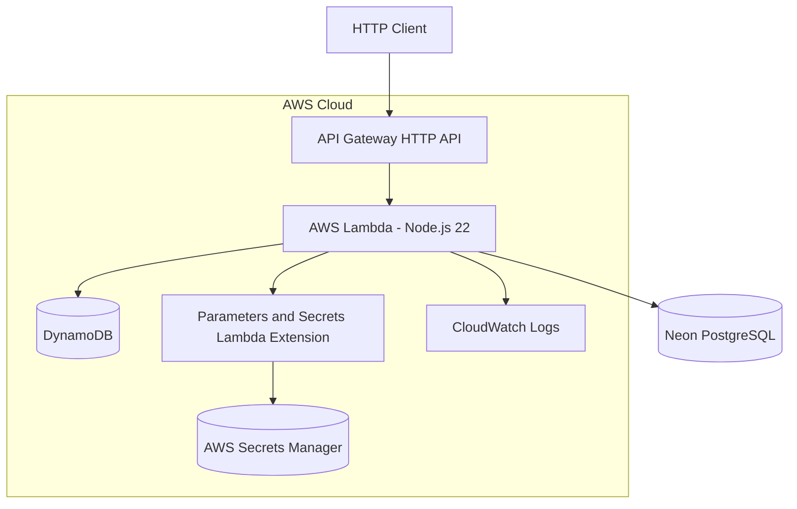
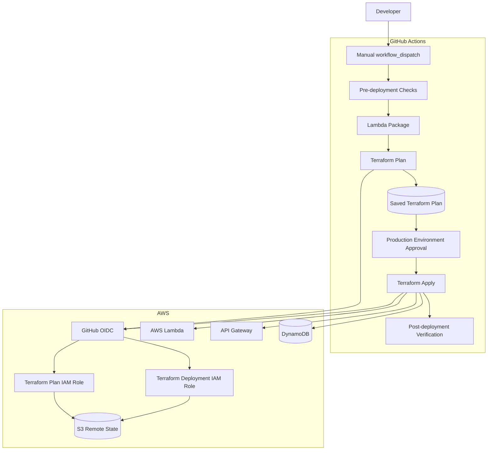

# Deployment and Infrastructure

This document describes the AWS infrastructure, Terraform configuration, secrets management and production deployment process for Orbis API.

## Infrastructure Overview

The application can run locally as a Node.js process or in production as an AWS Lambda function.

The production environment uses:

| Component | Responsibility |
|---|---|
| Amazon API Gateway HTTP API | Public HTTP entry point |
| AWS Lambda | Node.js application runtime |
| Amazon DynamoDB | Registration rate-limit storage |
| AWS Secrets Manager | Database and authentication secrets |
| Parameters and Secrets Lambda Extension | Runtime secret retrieval |
| Amazon CloudWatch Logs | Application and Lambda logs |
| Amazon S3 | Terraform remote state |
| GitHub Actions | CI/CD and production deployment |
| AWS IAM OIDC | GitHub Actions authentication |
| Neon | PostgreSQL hosting |

PostgreSQL is hosted by Neon, not Amazon RDS.

## Deployment Architecture



The Lambda function uses the `serverless-http` adapter to expose the Express application through API Gateway.

The Lambda is configured with:

| Configuration | Value |
|---|---|
| Runtime | `nodejs22.x` |
| Handler | `dist/lambda.handler` |
| Memory | 256 MB |
| Timeout | 15 seconds |
| Architecture | x86_64 |
| Database | Neon PostgreSQL |
| Database connection pool maximum | 2 connections per execution environment |

The function currently connects to Neon over the internet and is not attached to a VPC.

## Terraform Structure

Terraform configuration is maintained under `terraform/`.

```text
terraform/
├── modules/
│   ├── api-gateway/
│   ├── lambda/
│   ├── rate-limiting/
│   └── security/
├── main.tf
├── outputs.tf
├── provider.tf
├── variables.tf
└── versions.tf
```

### Root Configuration

The root Terraform configuration composes the infrastructure modules and passes their dependencies.

| Module | Responsibility |
|---|---|
| `api-gateway` | HTTP API, Lambda integration, routes and stage |
| `lambda` | Lambda function, deployment package and environment |
| `rate-limiting` | DynamoDB registration rate-limit table |
| `security` | Lambda execution role and IAM policies |

The AWS provider defaults to `us-east-1`.

The Terraform configuration requires Terraform `>= 1.5.0` and AWS provider `~> 6.0`.

### Lambda Deployment Package

The Lambda deployment package is generated through the Makefile:

```bash
make package
```

This command:

1. Compiles TypeScript.
2. Creates the `build/` directory.
3. Copies the compiled application into `build/`.
4. Copies `package.json` and `package-lock.json`.
5. Installs production dependencies into the staging directory.

Terraform packages the contents of `build/` into `terraform/lambda.zip`.

The Lambda handler is configured as:

```text
dist/lambda.handler
```

The deployment package must contain the compiled `dist/` directory and the production dependencies required by the application.

The `.env` file must never be included in the deployment package.

## AWS Secrets Management

Production credentials are stored in AWS Secrets Manager.

The current Terraform defaults are:

| Secret | Name |
|---|---|
| Database | `restaurant-cmv-api/database` |
| Authentication | `restaurant-cmv-api/authentication` |

These names can be overridden through Terraform variables.

### Database Secret

Create the database secret in AWS Secrets Manager.

Its JSON structure must be:

```json
{
  "DATABASE_URL": "postgresql://<user>:<password>@<host>/<database>?sslmode=require"
}
```

Use the appropriate Neon connection string.

For serverless workloads, use a Neon connection pooling endpoint where appropriate.

### Authentication Secret

The authentication secret uses this JSON structure:

```json
{
  "JWT_SECRET": "<base64-encoded-random-secret>"
}
```

The application validates the encoded value and requires at least 32 bytes of decoded random data.

The secret is provisioned and its retrieval capability is available in the infrastructure layer. It should not be confused with an authentication endpoint or complete authentication flow.

### Runtime Secret Retrieval

The Lambda function receives the secret ARNs through environment variables:

```text
DB_SECRET_ARN
AUTHENTICATION_SECRET_ARN
```

The Parameters and Secrets Lambda Extension retrieves secrets through its local HTTP endpoint.

The extension uses the Lambda execution environment's AWS session token for authentication.

The database connection is resolved lazily when the application initialises its database pool.

In local development, the application can use `DATABASE_URL` directly instead of a Secrets Manager ARN.

Never:

- Commit secrets to Git.
- Put secret values in Terraform variables or `.tfvars` files.
- Log database connection strings.
- Include `.env` in deployment artifacts.
- Expose secret values through API responses.

## DynamoDB Registration Rate Limiting

The rate-limiting module provisions a DynamoDB table for registration requests.

The table uses:

| Attribute | Key |
|---|---|
| `rate_limit_key` | Partition key |
| `window_start` | Sort key |
| `expires_at` | TTL attribute |

The table uses on-demand billing and server-side encryption.

The application applies registration rate limiting by source IP address.

Current default configuration:

| Setting | Value |
|---|---:|
| Maximum attempts | 5 |
| Window | 900 seconds |
| API Gateway sustained rate | 2 requests/second |
| API Gateway burst limit | 5 requests |

The application-level rate limiter uses atomic DynamoDB updates to enforce the per-IP request limit.

If the rate limiter cannot determine the request IP or DynamoDB is unavailable, registration fails closed with a service-unavailable response.

API Gateway throttling is an additional protection layer. It does not replace application-level per-IP rate limiting.

The Lambda execution role receives permission to update the rate-limit table.

## IAM Security

The Lambda execution role is provisioned by the Terraform security module.

Its permissions include:

- Basic Lambda execution and CloudWatch logging.
- `secretsmanager:GetSecretValue` for the configured database and authentication secrets.
- `dynamodb:UpdateItem` for the registration rate-limit table.

The role is restricted to the resources required by the Lambda function.

GitHub Actions uses separate IAM roles for Terraform planning and production deployment.

## Terraform Remote State

Terraform uses an Amazon S3 backend to share infrastructure state between authorised local operations and GitHub Actions.

Current backend configuration:

| Setting | Value |
|---|---|
| Backend | Amazon S3 |
| Bucket | `orbis-terraform-state-450753703757-us-east-1` |
| State key | `orbis/production/terraform.tfstate` |
| Region | `us-east-1` |
| Encryption | Enabled |
| State locking | S3 lockfile |

The backend configuration is defined in `terraform/versions.tf`.

The state bucket must exist before Terraform initialisation.

The bucket is provisioned separately from the Terraform configuration that uses it, avoiding a circular dependency during bootstrap.

The bucket should retain:

- Versioning.
- Server-side encryption.
- Public access blocking.
- A bucket policy requiring secure transport.

Terraform state and saved plan files may contain sensitive information. They must never be committed to Git or exposed in public artifacts.

The remote backend is shared by authorised local Terraform operations and the production deployment workflow.

## Local AWS Configuration

Install and configure the AWS CLI.

For example:

```bash
aws configure
```

Verify the active AWS identity:

```bash
aws sts get-caller-identity
```

The default Terraform region is `us-east-1`.

The configured AWS identity must have the permissions required for the intended operation.

### Terraform Initialization

Initialise the Terraform working directory:

```bash
terraform -chdir=terraform init
```

Validate the configuration:

```bash
make terraform-fmt
make terraform-validate
```

Preview infrastructure changes:

```bash
make terraform-plan
```

Apply changes locally only when explicitly authorised:

```bash
make terraform-apply
```

These commands require AWS credentials and access to the remote state backend.

Local Terraform operations are intended for controlled infrastructure maintenance and troubleshooting. They are not the standard production deployment procedure.

**Important:** `make deploy` executes the local deployment workflow defined in the Makefile. It runs tests, formats and validates Terraform, and applies infrastructure changes using the active local AWS credentials. Do not use it as a substitute for the approved production GitHub Actions workflow.

## GitHub Actions Production Deployment

Production deployment is initiated manually through GitHub Actions.

The workflow is:

```text
.github/workflows/deploy.yml
```

It uses `workflow_dispatch` and only runs when the selected branch is `main`.

The workflow requires a published Terms of Service version as an input.

### Deployment Pipeline



### Deployment Steps

The production workflow performs the following operations:

1. **Pre-deployment checks:** checks out the repository, installs dependencies, runs tests and builds the Lambda package.
2. **Terraform initialization:** initialises Terraform using the remote S3 backend.
3. **Terraform plan:** generates and saves an infrastructure plan.
4. **Plan artifact:** uploads the saved plan and Lambda archive as short-lived workflow artifacts.
5. **Production approval:** waits for approval through the GitHub Environment named `production`.
6. **Terraform apply:** applies the previously saved plan.
7. **Post-deployment verification:** checks the deployed `/health` and `/ready` endpoints.

The apply stage uses the same saved plan generated during the planning stage. It does not automatically generate a new plan after approval.

### Starting a Production Deployment

1. Open the repository on GitHub.
2. Navigate to the **Actions** tab.
3. Select **Production Deployment**.
4. Click **Run workflow**.
5. Select the `main` branch.
6. Enter the published Terms of Service version.
7. Start the workflow.

The deployment runs only after the pre-deployment checks and Terraform planning stage complete successfully.

The apply stage waits for an authorised reviewer to approve the `production` environment.

### GitHub Configuration

The repository requires the following GitHub Actions variables:

| Variable | Purpose |
|---|---|
| `AWS_REGION` | AWS deployment region |
| `AWS_PLAN_ROLE_ARN` | IAM role assumed during Terraform planning |
| `AWS_ROLE_ARN` | IAM role assumed during production deployment |

The GitHub repository must be configured with:

- An AWS IAM OIDC identity provider for GitHub Actions.
- An IAM role for Terraform planning.
- An IAM role for production deployment.
- Trust policies restricted to the authorised repository and workflow context.
- A protected GitHub Environment named `production`.
- Required reviewers for production approval.

The workflow uses OIDC federation rather than long-lived AWS access keys stored as GitHub Secrets.

### Deployment Permissions

The workflow uses distinct roles for planning and applying infrastructure changes.

| Role | Responsibility |
|---|---|
| Terraform Plan Role | Read infrastructure and generate a Terraform plan |
| Terraform Deployment Role | Apply the approved infrastructure plan |

The roles should follow least-privilege principles.

The production environment approval must be configured in GitHub repository settings. A workflow environment declaration alone does not establish reviewer protection.

## Post-deployment Verification

After Terraform applies the saved plan, the workflow retrieves the deployed API URL from Terraform outputs.

It then verifies:

```text
GET /health
GET /ready
```

The health endpoint verifies that the application responds.

The readiness endpoint verifies that the application can connect to PostgreSQL.

Both checks must succeed for the workflow to complete successfully.

### Manual Verification

The Makefile provides commands for checking the deployed API:

```bash
make health
make ready
make check
```

Inspect the Lambda configuration:

```bash
make status
```

Follow CloudWatch logs:

```bash
make logs
```

These commands use the API URL and AWS region currently configured in the Makefile.

## Troubleshooting

### API Health Check Fails

Investigate:

- Lambda function state.
- API Gateway integration.
- Lambda execution logs.
- Recent Terraform changes.
- Deployment package contents.

### API Health Works but Readiness Fails

Investigate:

- Neon database availability.
- Database connection string.
- Database credentials in Secrets Manager.
- Lambda IAM permissions.
- Parameters and Secrets Lambda Extension availability.
- Database connection limits.
- Lambda CloudWatch logs.

Do not print or share the database connection string while troubleshooting.

### Registration Returns HTTP 429

The registration rate limiter has rejected the request.

Check:

- The source IP address.
- The configured rate-limit maximum attempts.
- The rate-limit window.
- DynamoDB table availability.

### Registration Returns HTTP 503

The rate limiter may be unavailable or the source IP address may be missing from the API Gateway event.

Inspect the Lambda logs and DynamoDB permissions.

### Terraform State Lock Errors

Check whether another Terraform operation is currently running.

Do not manually delete a state lock without verifying that the operation holding it has stopped.

Use the normal Terraform state-lock recovery procedure when necessary.

## Operational Considerations

- Keep AWS IAM permissions restricted to required resources.
- Use OIDC instead of long-lived AWS access keys.
- Protect the GitHub `production` environment with reviewer approval.
- Review the saved Terraform plan before approving deployment.
- Apply only the plan that was reviewed.
- Keep Terraform state versioning enabled.
- Restrict access to the Terraform state bucket.
- Never commit Terraform state, saved plans or deployment archives.
- Monitor Lambda concurrency and PostgreSQL connection usage.
- Each warm Lambda execution environment maintains its own PostgreSQL connection pool.
- Use Neon connection pooling where appropriate for serverless workloads.
- Keep database migrations versioned and reviewed.
- Run integration tests against disposable databases.
- Never run automated integration tests against production databases.
- Keep `.env` and all credentials outside the deployment package.
