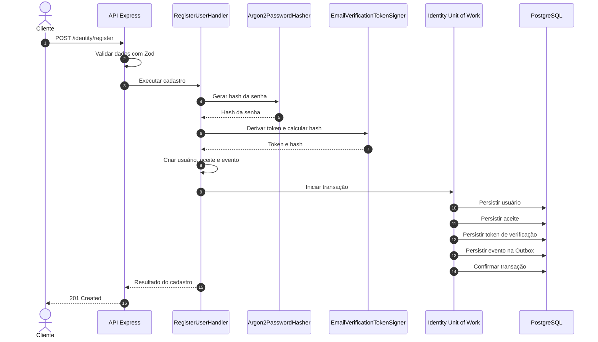
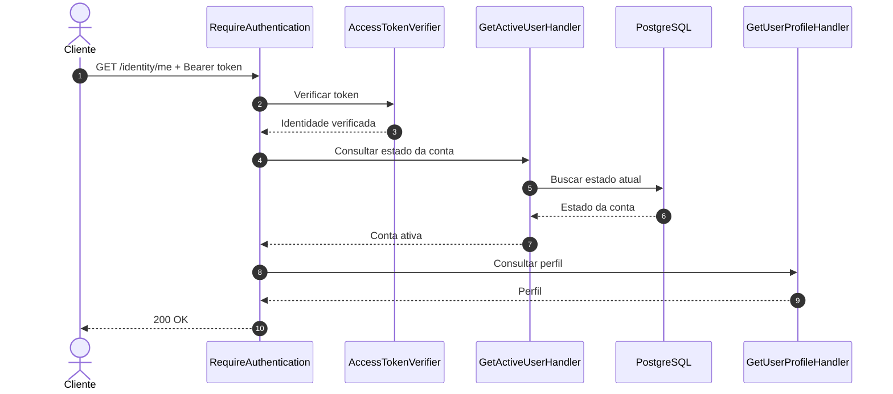

# Módulo Identity

O módulo **Identity** é responsável pelo ciclo de vida da conta e pelas operações de identidade e autenticação da Orbis.

Suas responsabilidades incluem cadastro, autenticação, verificação de e-mail, consulta do perfil autenticado e validação do estado atual da conta.

O módulo não é responsável pela entrega de e-mails. Ele registra eventos na Outbox, que processa esses eventos de forma assíncrona. Consulte [Outbox](outbox.md).

## Responsabilidades

- Criar contas e validar os dados de cadastro.
- Normalizar endereços de e-mail e garantir sua unicidade.
- Armazenar senhas utilizando hash Argon2id.
- Registrar o aceite dos Termos de Serviço.
- Criar tokens de verificação de e-mail.
- Autenticar usuários e emitir tokens de acesso.
- Verificar tokens de acesso recebidos em rotas protegidas.
- Impedir o acesso de contas que não estejam ativas.
- Disponibilizar o perfil do usuário autenticado.

## Organização interna

```text
src/modules/identity/
├── application/
│   ├── commands/
│   │   ├── register-user.handler.ts
│   │   ├── login.handler.ts
│   │   └── verify-email.handler.ts
│   ├── queries/
│   │   ├── get-user-profile.handler.ts
│   │   └── get-active-user.handler.ts
│   └── ports/
│
├── domain/
│   ├── value-objects/
│   ├── user.ts
│   ├── terms-acceptance.ts
│   ├── email-verification-token.ts
│   └── email-verification-requested.event.ts
│
└── infrastructure/
    ├── cryptography/
    └── persistence/
        └── repositories/
```

Os nomes e a quantidade de arquivos podem evoluir. O princípio é manter as regras de negócio e os casos de uso no módulo, enquanto as implementações concretas ficam nos adaptadores de infraestrutura.

## Estados da conta

O fluxo de cadastro utiliza os seguintes estados relevantes:

| Estado | Significado |
|---|---|
| `pending_email_verification` | Cadastro realizado, mas o endereço de e-mail ainda não foi confirmado |
| `active` | Conta com verificação concluída e autorizada a utilizar as rotas protegidas |
| `suspended` | Conta suspensa e sem acesso às rotas protegidas |

Uma conta recém-cadastrada não recebe acesso autenticado antes da confirmação do endereço de e-mail.

O estado atual é consultado no banco durante a autenticação de requisições protegidas. Portanto, um token de acesso ainda válido não concede acesso a uma conta que tenha sido suspensa ou que não esteja mais ativa.

## Cadastro

**Endpoint:** `POST /identity/register`

O endpoint valida o corpo da requisição com Zod antes de executar `RegisterUserHandler`.

O caso de uso:

1. Calcula o hash da senha com Argon2id.
2. Gera o identificador da conta.
3. Cria o usuário no estado `pending_email_verification`.
4. Normaliza o endereço de e-mail por meio do objeto de valor `Email`.
5. Registra o aceite dos Termos de Serviço com a versão definida pela configuração da aplicação.
6. Gera o contexto e o token de verificação de e-mail.
7. Persiste somente o hash do token de verificação.
8. Cria o evento `EmailVerificationRequested`.
9. Persiste usuário, aceite, token e evento da Outbox na mesma transação.

A transação garante que os registros relacionados sejam confirmados ou revertidos em conjunto.

O cliente não controla o horário do aceite nem a versão dos Termos de Serviço. Esses valores são definidos pela aplicação.

### Fluxo de cadastro



## Verificação de e-mail

**Endpoint:** `POST /identity/verify-email`

O caso de uso `VerifyEmailHandler` recebe o token de verificação e calcula seu hash para localizar e consumir o registro persistido.

A operação ocorre em uma transação:

1. Consome o token de verificação ainda válido.
2. Atualiza o estado da conta para `active`.
3. Confirma a transação.

Se o token não existir, estiver expirado ou já tiver sido consumido, a operação falha com `InvalidEmailVerificationTokenError`.

O token é de uso único. O banco armazena seu hash, não o valor bearer enviado ao usuário.

O token de verificação possui validade de 24 horas, definida no caso de uso de cadastro.

## Login

**Endpoint:** `POST /identity/login`

O caso de uso `LoginHandler`:

1. Normaliza o e-mail informado.
2. Busca a conta pelo endereço normalizado.
3. Verifica a senha com o adaptador de hash.
4. Confirma que a conta está no estado `active`.
5. Emite um token de acesso.

Credenciais incorretas e contas que não estejam ativas resultam em `InvalidCredentialsError`. A resposta HTTP não revela se o e-mail existe ou se a senha está incorreta.

O token é retornado no formato Bearer, acompanhado de sua data de expiração.

## Autenticação de requisições

**Endpoint protegido:** `GET /identity/me`

O middleware `createRequireAuthentication` executa as seguintes verificações:

1. Exige o cabeçalho `Authorization`.
2. Valida o formato `Bearer <token>`.
3. Verifica a assinatura, o algoritmo, o emissor, o público e a validade temporal do JWT.
4. Consulta o estado atual da conta por meio de `GetActiveUserHandler`.
5. Disponibiliza a identidade verificada em `res.locals.auth`.
6. Encaminha a requisição para o handler da rota.

Tokens inválidos ou expirados e contas inativas recebem HTTP 401.

A consulta do estado atual é intencional: a autorização não depende exclusivamente das informações que estavam no token quando ele foi emitido.

### Fluxo de autenticação



## Tokens de acesso

A implementação utiliza JWT assinado com HMAC-SHA256 (`HS256`).

O verificador valida:

- Algoritmo permitido: `HS256`.
- Emissor: `orbis`.
- Público: `orbis-api`.
- Identificador do usuário (`sub`).
- Data de emissão (`iat`).
- Data de expiração (`exp`).

O segredo de assinatura é obtido pela camada de infraestrutura de segredos. Ele deve possuir pelo menos 32 bytes de material aleatório após a decodificação.

O token de acesso é um bearer token. Quem o possui pode apresentá-lo até sua expiração, desde que a conta continue ativa. A verificação do estado atual da conta impede o uso de tokens por contas suspensas ou inativas, mas não equivale a uma lista de revogação individual de JWTs.

## Respostas HTTP

| Operação | Situação | Resposta |
|---|---|---|
| Cadastro | Dados aceitos | `201 Created` |
| Cadastro | Dados inválidos | `400 Bad Request` |
| Cadastro | E-mail já cadastrado | `409 Conflict` |
| Login | Autenticação válida | `200 OK` |
| Login | Credenciais inválidas ou conta inativa | `401 Unauthorized` |
| Verificação | Token válido | `200 OK` |
| Verificação | Token inválido, expirado ou consumido | `400 Bad Request` |
| Perfil | Usuário autenticado e ativo | `200 OK` |
| Perfil | Ausência de autenticação ou conta inativa | `401 Unauthorized` |

Erros inesperados são tratados como erros internos, sem expor detalhes de implementação ao cliente.

## Persistência e transações

A persistência específica do Identity fica em:

```text
src/modules/identity/infrastructure/persistence/
```

Os adaptadores utilizam o cliente Drizzle compartilhado em `src/infrastructure/database/`.

O `IdentityUnitOfWork` fornece transações para operações que precisam manter consistência entre múltiplas gravações.

No cadastro, usuário, aceite dos Termos de Serviço, token de verificação e evento da Outbox são persistidos na mesma transação.

## Integração com Outbox

O Identity não envia e-mails diretamente.

Durante o cadastro, o caso de uso persiste o evento `EmailVerificationRequested` na Outbox, junto com os demais registros da operação.

O módulo Outbox é responsável por localizar o destinatário, gerar o link de verificação, renderizar o e-mail e solicitar seu envio pelo provedor configurado.

Essa separação evita que a disponibilidade de um serviço externo de e-mail determine o sucesso da transação de cadastro.

Consulte [Outbox](outbox.md) para detalhes do processamento.

## Testes

Os testes do Identity devem cobrir, entre outros cenários:

- Normalização e unicidade de e-mail.
- Hash e verificação de senha.
- Registro transacional do usuário e dos dados associados.
- Reversão da transação quando uma persistência falha.
- Rejeição de credenciais inválidas.
- Rejeição de contas pendentes ou suspensas no login.
- Consumo único e expiração do token de verificação.
- Validação de JWT.
- Bloqueio de requisições quando a conta não está ativa.
- Consulta do perfil autenticado.

Execute:

```bash
make test
```
