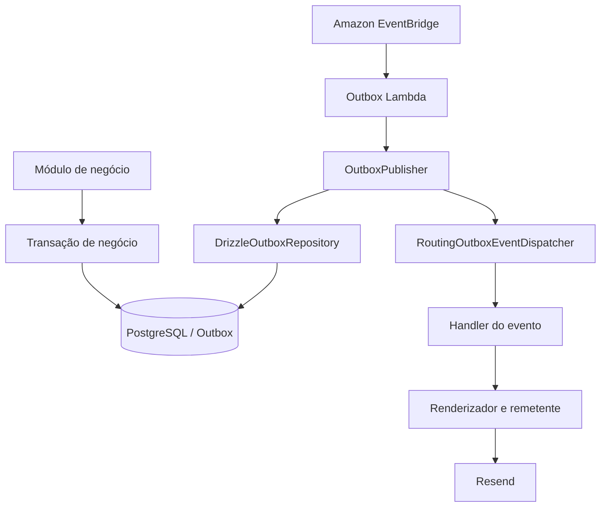

# Módulo Outbox

O módulo **Outbox** processa eventos persistidos transacionalmente pelos módulos de negócio e realiza seus efeitos externos de forma assíncrona.

Na implementação atual, o principal fluxo é a entrega do e-mail de verificação de cadastro por meio do Resend.

O módulo mantém a persistência do evento separada de sua entrega. Assim, uma falha temporária do provedor de e-mail não exige que a operação de cadastro seja repetida.

## Responsabilidades

- Consultar eventos pendentes persistidos no banco.
- Reservar eventos para processamento concorrente com leases.
- Encaminhar eventos ao handler correspondente.
- Confirmar eventos processados.
- Agendar novas tentativas em caso de falha.
- Encaminhar eventos que excedam o limite de tentativas para dead-letter.
- Registrar informações de falha para diagnóstico.
- Entregar e-mails por meio de adaptadores externos.

O módulo não é responsável por decidir quando um evento de negócio deve ser criado. Essa decisão pertence ao módulo que executa a operação de negócio.

## Organização interna

```text
src/modules/outbox/
├── application/
│   ├── ports/
│   ├── outbox-publisher.ts
│   ├── routing-outbox-event-dispatcher.ts
│   └── email-verification-requested.handler.ts
│
└── infrastructure/
    ├── persistence/
    │   ├── drizzle-outbox-repository.ts
    │   └── drizzle-email-verification-recipient-repository.ts
    │
    └── email/
        ├── resend-email-sender.ts
        ├── ejs-email-template-renderer.ts
        └── templates/
```

A composição do módulo fica em `src/bootstrap/outbox.ts`. O ponto de entrada da execução agendada fica em `src/outbox-lambda.ts`.

## Relação com os módulos de negócio

Os módulos de negócio persistem eventos na Outbox dentro de suas próprias transações.

No fluxo de cadastro do Identity, a mesma transação persiste:

- Usuário.
- Aceite dos Termos de Serviço.
- Token de verificação.
- Evento `EmailVerificationRequested`.

O evento só fica disponível para processamento se a transação de cadastro for confirmada.

O módulo Identity não conhece Resend, EJS ou a Lambda de processamento. Ele conhece apenas o contrato de persistência do evento.

## Fluxo de processamento



A execução ocorre em uma Lambda separada da Lambda HTTP. O EventBridge agenda sua invocação periodicamente.

## Reserva de eventos e leases

O `DrizzleOutboxRepository` reserva um lote de eventos elegíveis em uma transação PostgreSQL.

Um evento pode ser reservado quando:

- Ainda não foi publicado.
- Ainda não foi encaminhado para dead-letter.
- Sua data de disponibilidade já foi alcançada.
- Não possui lease ativo, ou o lease anterior expirou.

A consulta ordena os candidatos por disponibilidade e criação. O bloqueio `FOR UPDATE SKIP LOCKED` permite que processadores concorrentes reservem conjuntos diferentes de eventos sem bloquear uns aos outros desnecessariamente.

Cada evento reservado recebe:

- Um `leaseToken` aleatório.
- Uma data de expiração do lease.
- O incremento do contador de tentativas.

O token do lease funciona como uma credencial de posse da reserva. As operações de confirmação e falha exigem o mesmo token. Assim, um worker que perdeu sua reserva não pode atualizar o estado de um evento que já foi reservado por outro worker.

A reserva não mantém a transação do banco aberta durante a chamada ao serviço externo.

## Publicação em lote

O `OutboxPublisher` coordena o processamento de cada lote:

1. Solicita ao repositório um lote de eventos elegíveis.
2. Encaminha cada evento ao dispatcher.
3. Se o handler concluir, tenta marcar o evento como publicado.
4. Se o handler falhar, calcula a próxima tentativa e registra a falha.
5. Se o limite de tentativas tiver sido alcançado, marca o evento como dead-letter.
6. Se o lease não puder mais ser confirmado, contabiliza a perda da reserva.

O resultado do lote contém:

| Campo | Significado |
|---|---|
| `claimed` | Quantidade de eventos reservados |
| `published` | Quantidade confirmada como publicada |
| `failed` | Quantidade cuja nova tentativa foi agendada |
| `deadLettered` | Quantidade encaminhada para dead-letter |
| `leaseLost` | Quantidade cuja reserva não pôde ser confirmada |

## Retentativas e dead-letter

O intervalo entre tentativas utiliza backoff exponencial limitado por um valor máximo.

A fórmula aplicada é:

```text
min(retryBaseDelayMs * 2^(attempts - 1), retryMaxDelayMs)
```

Os valores são configurados por `src/config/outbox.ts` e validados pelo esquema de configuração do publisher.

A configuração atualmente definida na infraestrutura da Lambda utiliza:

| Configuração | Valor |
|---|---:|
| Tamanho do lote | 25 |
| Duração do lease | 60.000 ms |
| Máximo de tentativas | 10 |
| Intervalo inicial | 1.000 ms |
| Intervalo máximo | 900.000 ms |
| Agendamento | A cada 1 minuto |

Quando o limite de tentativas é atingido, o evento recebe `deadLetteredAt` e deixa de ser elegível para processamento normal.

O último erro é armazenado em `lastError`. O tratamento operacional e eventual reprocessamento de eventos em dead-letter devem ser realizados por procedimento controlado; não se deve presumir que exista reprocessamento automático.

## Dispatcher e handlers

O `RoutingOutboxEventDispatcher` recebe um registro de handlers indexado pelo tipo do evento.

Ele localiza o handler correspondente e encaminha o evento. Caso não exista handler registrado para o tipo recebido, lança `UnsupportedOutboxEventError`.

O registro atual inclui:

```text
identity.email_verification_requested.v1
```

Esse tipo é tratado por `EmailVerificationRequestedHandler`.

A validação do registro impede tipos duplicados.

## Entrega do e-mail de verificação

O `EmailVerificationRequestedHandler` coordena a preparação e o envio da mensagem.

Em linhas gerais, o handler:

1. Interpreta os dados do evento.
2. Localiza o destinatário associado ao usuário.
3. Deriva o token bearer a partir do contexto do token de verificação.
4. Monta a URL pública de verificação.
5. Renderiza as versões HTML e texto do e-mail.
6. Solicita o envio pelo adaptador `EmailSender`.

O adaptador `EjsEmailTemplateRenderer` carrega os templates HTML e texto de e-mail.

O adaptador `ResendEmailSender` utiliza o SDK do Resend. A chamada inclui uma chave de idempotência associada à mensagem para reduzir o risco de envio duplicado em novas tentativas.

A chave de idempotência do provedor não substitui a semântica de entrega do Outbox. Uma falha após o provedor aceitar a mensagem, mas antes da confirmação no banco, ainda exige atenção ao comportamento de repetição.

## Token de verificação

O evento persistido não deve conter o token bearer em texto puro.

O fluxo utiliza o contexto persistido do token e o assinador de verificação para derivar o bearer token durante o processamento. O banco armazena o hash do token, não o valor que será apresentado pelo usuário.

O segredo criptográfico de verificação é independente do segredo utilizado para assinar JWTs de acesso.

O token bruto e os segredos criptográficos não devem ser registrados em logs nem incluídos no payload da Outbox.

## Execução na AWS

A execução do Outbox possui um ponto de entrada independente:

```text
src/outbox-lambda.ts
```

A função obtém o publisher composto em `src/bootstrap/outbox.ts` e executa `publishBatch()`.

A infraestrutura Terraform provisiona:

- Uma Lambda dedicada ao Outbox.
- Uma regra agendada do Amazon EventBridge.
- Um alvo EventBridge apontando para a Lambda.
- Permissão para o EventBridge invocar a função.

O handler configurado para a função é:

```text
dist/outbox-lambda.handler
```

A Lambda utiliza o mesmo pacote de implantação da aplicação, mas possui função, configuração e papel de execução próprios.

A frequência do agendamento é definida por `outbox_schedule_expression`.

## Falhas e observabilidade

A Lambda registra o resultado agregado de cada lote. O publisher diferencia falhas recuperáveis, eventos encaminhados para dead-letter e perda de lease.

As mensagens de erro persistidas devem ser tratadas como dados operacionais. Não inclua credenciais, tokens bearer ou segredos nos erros lançados pelos adaptadores.

Para investigar falhas:

- Consulte os logs da função Outbox no CloudWatch.
- Verifique os contadores retornados pelo publisher.
- Inspecione `attempts`, `availableAt`, `leaseExpiresAt`, `deadLetteredAt` e `lastError`.
- Verifique a disponibilidade do PostgreSQL e do provedor Resend.
- Confirme as permissões IAM e os segredos necessários à função.

## Garantias e limites

A Outbox garante a persistência atômica do evento junto à transação de negócio e coordena tentativas de processamento com leases.

Ela não deve ser descrita como garantia geral de entrega exatamente uma vez. Chamadas externas podem ser repetidas em cenários de falha entre o efeito externo e a confirmação no banco.

Por isso:

- Handlers devem considerar a possibilidade de repetição.
- Integrações externas devem utilizar idempotência quando suportada.
- A confirmação de um evento deve validar seu lease.
- Eventos em dead-letter exigem tratamento operacional explícito.

## Testes

Os testes devem cobrir:

- Reserva de lotes e concorrência.
- Exclusão de eventos publicados ou em dead-letter.
- Expiração e perda de lease.
- Confirmação de publicação.
- Agendamento de retentativas.
- Backoff exponencial e limite máximo.
- Encaminhamento para dead-letter.
- Tipos de evento sem handler registrado.
- Falhas de renderização e envio.
- Chave de idempotência no adaptador de e-mail.

Execute a suíte:

```bash
make test
```
